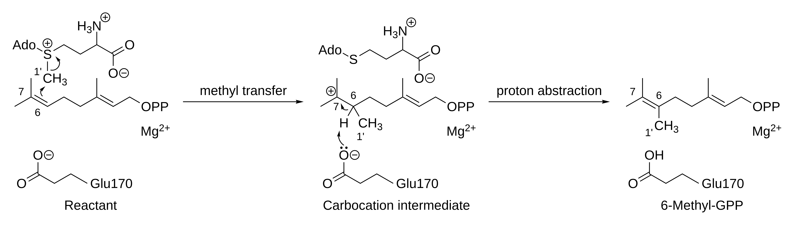
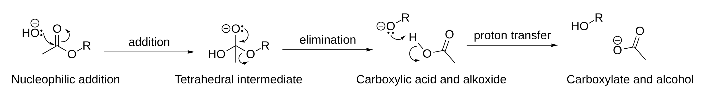
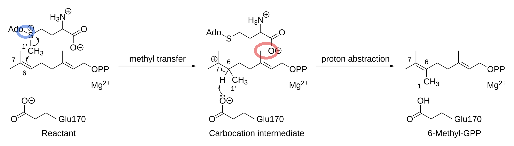
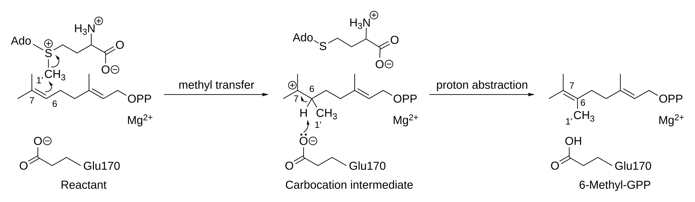

# `reaction-draw` skill v1.0.0

[English](README.md) | 日本語

**AIエージェント**に、**化学構造式**と巻矢印つきの**反応機構**を描かせるskillのプラグインです。有機反応の説明や、教科書的な反応名、手書きの画像、論文をもとにして、PNG、SVG、CDXML形式の画像を作成させることができます。

IUPACの反応機構の描画規則と、化学描画アプリ[Octet Draw](https://github.com/SamChemMan/Octet-Draw)をベースにskill化しています。

## 使用例

有機反応、残基ラベルつきの酵素反応、金属錯体、ラジカル、遷移状態などに対応しており、以下のようなpromptで例のような反応機構の画像を描画させられます。

> 論文のPDF（doi:10.1002/anie.202111217）をもとに、BezA のメチル基転移の反応機構を描いてください。SAM が GPP の C6 をメチル化して C7 カチオンが生じ、続いて Glu170 が C6 のプロトンを引き抜きます。

|  |
| :--- |

---

> 求核アシル置換の反応機構例を描いてください。

|  |
| :--- |

## インストール方法

AIエージェントに、「https://github.com/t-0hmura/reaction-draw のskillをインストールして」と指示してください。使用している環境に合わせて、[このドキュメント](docs/install.ja.md)のいずれかの方法でインストールできます。

## 使い方

エージェントに、たとえば次のように指示します。

> この論文で提案されている反応機構を、reaction-draw スキルで巻矢印の図にしてください。

これにより、エージェントは内蔵されているスクリプトで図を描画したのち、図を検査して微調整します。出力は基本的に `[figure].cdxml`、`[figure].svg`、`[figure].png` です。

図をさらに微調整したいときは、直したい箇所を、以下の例のような文面や画像で説明して修正を指示してください。エージェントが入力ファイルを直して描き直します。

> 赤丸の箇所は余白あけて、青丸の箇所は結合伸ばしてください。
> 

エージェント（Claude Sonnet 5.5）が、この画像と上の指示から描き直した図です。

|  |
| :--- |

## ベンチマークしたモデル

Claude の 2 モデルと GPT の 2 モデル（effort: high）に 11 種類の反応機構を描画させました。Sonnet 5.5 high と Sol 6.1 high は、ほぼすべてを正確に描画できました。Haiku 5.5 high も全問で実用的な図を出力しましたが、化学的な細部に抜けが多く見られました。一方、Luna 6 high はいくつかの酵素反応機構で誤りがありました。全件を並列実行した際の 1 枚あたりの所要時間は、Sonnet 5.5 high が約 12 分、Haiku 5.5 high が約 7 分、Sol 6.1 high が約 8 分、Luna 6 high が約 12 分でした。詳細は [docs/benchmark](docs/benchmark/README.ja.md) を参照してください。
## 限界

複雑な反応機構や論文中で暗黙的に省略されている原子の移動がある場合、出力される図が誤る場合があります。説明を詳細にしたり、出力された図を微調整するよう具体的な指示を与えてみてください。

## ライセンス

`reaction-draw` skillは、Apache License 2.0 の下で配布されます。Octet Draw（Apache-2.0）のビルド済みのコードを同梱しています。詳細は `LICENSE` と `NOTICE` を見てください。

## ヘルプ

質問、問題の報告や機能の要望は [Issues](https://github.com/t-0hmura/reaction-draw/issues) へお寄せください。
