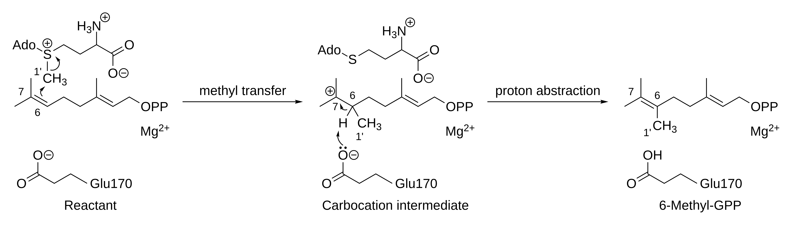
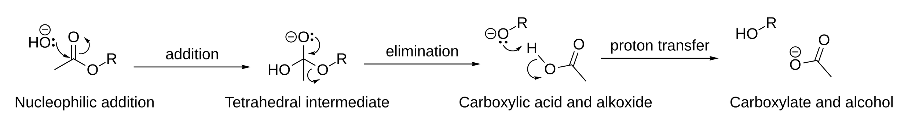
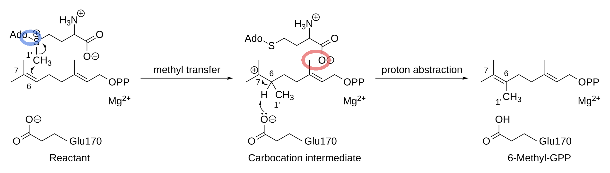
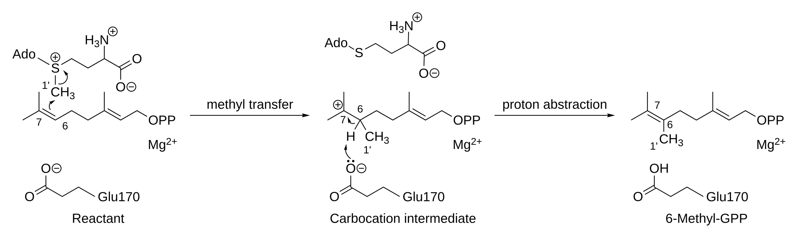

# `reaction-draw` skill v1.0.0

English | [日本語](README.ja.md)

A **skill** plugin that lets **AI agents** draw **chemical structures and reaction mechanisms** with curved arrows. From a description of an organic reaction, a textbook reaction name, a hand-drawn image or a paper, the agent makes the figure as PNG, SVG and CDXML files.

The skill is built on the IUPAC rules for drawing reaction mechanisms and on the chemical drawing app [Octet Draw](https://github.com/SamChemMan/Octet-Draw).

## Examples

It handles organic reactions, enzyme mechanisms with residue labels, metal complexes, radicals and transition states. Prompts like these give figures like the ones below.

> From the PDF of the paper (doi:10.1002/anie.202111217), draw the methyl-transfer mechanism of BezA: SAM methylates C6 of GPP to give the C7 cation, then Glu170 removes the C6 proton.

|  |
| :--- |

---

> Draw an example mechanism of nucleophilic acyl substitution.

|  |
| :--- |

## Installation

Ask your AI agent to "install the skill from https://github.com/t-0hmura/reaction-draw". You can install it in one of the ways in [this document](docs/install.md) that fits your environment.

## Usage

Ask the agent, for example:

> Draw the reaction mechanism proposed in this paper as a curved-arrow figure with the reaction-draw skill.

The agent draws the figure with the bundled scripts, then checks and corrects it. The output is usually `[figure].cdxml`, `[figure].svg` and `[figure].png`.

To adjust a figure further, describe what to change in words or on the image, as in the example below, and ask for the fix. The agent edits the input file and redraws the figure.

> Add space at the red circle, and lengthen the bond at the blue circle.
> 

The agent (Claude Sonnet 5.5) redrew the figure from this image and the prompt above:

|  |
| :--- |

## Benchmarked models

We evaluated two Claude models and two GPT models on 11 reaction mechanisms at high effort, running all problems in parallel. Sonnet 5.5 high (~12 min/figure) and Sol 6.1 high (~8 min/figure) drew nearly all mechanisms correctly. Haiku 5.5 high (~7 min/figure) produced a usable figure for every problem, though often with minor chemistry gaps, while Luna 6 high (~12 min/figure) missed some enzyme mechanisms. See [docs/benchmark](docs/benchmark/README.md) for details.
## Limitations

The figure may be wrong for complex mechanisms or when the paper leaves some atom movements implicit. In that case, describe the mechanism in more detail, or give specific instructions to correct the figure.

## License

The `reaction-draw` skill is distributed under the Apache License 2.0. It bundles prebuilt code of Octet Draw (Apache-2.0). See `LICENSE` and `NOTICE` for details.

## Help

If you have questions, bug reports or feature requests, please post them in [Issues](https://github.com/t-0hmura/reaction-draw/issues).
