# ベンチマーク

[English](README.md) | [日本語](README.ja.md)

4 つのモデル（effort は high）に 11 問の反応機構を描かせました（計 44 回）。Claude のモデル（Sonnet 5.5・Haiku 5.5）は Claude Code で、GPT のモデル（Sol 6.2・Luna 6）は Codex CLI で動かしました。結果は **PASS 26、PARTIAL 15、FAIL 3** で、描画の自動検査には 44 回のうち 43 回が合格しました。以下に prompt、結果、各回の出力図を示します。

## 条件と prompt

各回は、skill のフォルダー（`./reaction-draw/`）と、論文の問題では対象論文（`./paper/`、Orf30 は Supporting Information を含む）のみを配置したディレクトリで開始しました。Claude Code は `claude -p --safe-mode`、Codex CLI は空の `HOME` 環境で実行しました。各エージェントには以下の prompt を 1 回だけ渡し、追加の指示は与えていません。

論文の問題（`<DOI>` は論文の DOI）：

```text
Draw the enzyme reaction mechanism proposed in the paper in ./paper/ (doi:<DOI>) as a curved-arrow figure. Use the skill in ./reaction-draw/. Work in this directory and save the figure in ./out/.
```

コリスミ酸ムターゼ（遷移状態つき）：

```text
Draw the enzyme reaction mechanism proposed in the paper in ./paper/ (doi:<DOI>), including its transition state, as a curved-arrow figure. Use the skill in ./reaction-draw/. Work in this directory and save the figure in ./out/.
```

教科書の問題（`<TOPIC>` は下記）：

```text
Draw the reaction mechanism of <TOPIC> as a curved-arrow figure. Use the skill in ./reaction-draw/. Work in this directory and save the figure in ./out/.
```

- Chymotrypsin: the hydrolysis of a peptide bond by chymotrypsin (catalytic triad Ser195, His57, Asp102; oxyanion hole), acylation and deacylation,
- Aldol condensation: the base-catalysed (hydroxide) aldol condensation of two acetaldehyde molecules to crotonaldehyde
- Radical addition: the peroxide-initiated radical addition of HBr to propene giving 1-bromopropane (initiation and the two propagation steps)
- Carbonic anhydrase: the hydration of CO2 by carbonic anhydrase II (Zn2+ bound to His94, His96 and His119; the zinc-bound hydroxide attacks CO2; bicarbonate release and regeneration of the zinc-bound hydroxide)

## 採点

描画の自動検査とは別に、独立した採点役として GPT Sol 6.2 xhigh を用い、各図を論文の反応機構図（教科書の問題では教科書の機構を書き起こしたもの）と比較して、化学的な正しさ、skill の使い方、読みやすさを評価しました。

- PASS：参照元の反応機構を十分に正しく表しており、描画の自動検査にすべて合格し、視覚的にも読みやすい。
- PARTIAL：図として成立しているが、化学的な記述に一部不足があるか、描画の自動検査に不合格項目がある。
- FAIL：化学的に誤っている、重要な反応段階が欠けている、または図が出力されていない。

以下に示す判定および PARTIAL・FAIL の理由は、この採点役による評価結果です。

## モデルごとの要約

各行は、各モデルで 11 問を 1 回ずつ（effort は high）実行した結果の集計です。時間、トークン数、費用は 1 回あたりの中央値です。Claude の入力トークン数は通常入力・キャッシュ書き込み・キャッシュ読み込みの合計で、出力トークン数には思考トークンを含みます。費用は定価に基づく米ドルの概算です。Codex は CLI が出力する `tokens used` の合計値のみを記録しました。Claude と Codex ではトークンの集計方法が異なるため、数値を直接比較することはできません。

| モデル | 回数 | PASS | PARTIAL | FAIL | 時間の中央値（m:ss） | Claude のトークン数の中央値（入力 + 出力） | Codex のトークン数の中央値（合計） | Claude の API 費用の中央値 |
|---|---:|---:|---:|---:|---:|---:|---:|---:|
| Sonnet 5.5 high | 11 | 7 | 4 | 0 | 2:28 | 583,169 | — | $0.41 |
| Haiku 5.5 high | 11 | 5 | 6 | 0 | 5:07 | 1,024,577 | — | $0.05 |
| Sol 6.2 high | 11 | 9 | 2 | 0 | 4:17 | — | 67,026 | — |
| Luna 6 high | 11 | 5 | 3 | 3 | 4:22 | — | 51,954 | — |

## 問題ごとの図

時間は経過時間、`検査` は最終出力図に対する自動検査のスコアです。図をクリックすると 150 dpi の画像が開きます。

### BezA

doi:10.1002/anie.202111217。参照：Figure 4。

| モデル | 時間（m:ss） | 検査 | 判定 | PARTIAL・FAIL の理由 | Claude のトークン数（入力 + 出力） | Codex のトークン数（合計） | Claude の API 費用 | 図 |
|---|---:|---|---|---|---:|---:|---:|---|
| Sonnet 5.5 high | 1:19 | 46/46 | PASS | — | 649,072 | — | $0.34 | [](figures/beza_sonnet_high.png) |
| Haiku 5.5 high | 1:26 | 46/46 | PASS | — | 594,376 | — | $0.02 | [](figures/beza_haiku_high.png) |
| Sol 6.2 high | 2:25 | 46/46 | PASS | — | — | 53,553 | — | [](figures/beza_gpt-6.2-sol_high.png) |
| Luna 6 high | 1:14 | 49/49 | PASS | — | — | 45,001 | — | [](figures/beza_gpt-6-luna_high.png) |

### Orf30

doi:10.1021/jacs.6c13085。参照：Figure S14 と本文。

| モデル | 時間（m:ss） | 検査 | 判定 | PARTIAL・FAIL の理由 | Claude のトークン数（入力 + 出力） | Codex のトークン数（合計） | Claude の API 費用 | 図 |
|---|---:|---|---|---|---:|---:|---:|---|
| Sonnet 5.5 high | 6:09 | 47/47 | PARTIAL | 環化と生成物の立体は論文図と一致し、補酵素 PLP の再生段階には Lys238 の脱プロトン化と求核攻撃を示す巻き矢印が不足しています。 | 1,135,156 | — | $0.77 | [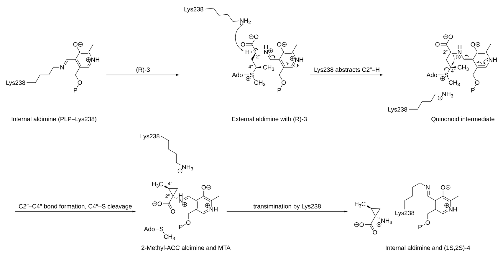](figures/orf30_sonnet_high.png) |
| Haiku 5.5 high | 13:00 | 47/47 | PARTIAL | 環化と生成物の立体化学は正しく描かれていますが、生成物放出段階で Lys238 がプロトン化されたままで、攻撃の巻矢印がなく、最初の巻矢印は PLP の結合と交差しています。 | 1,262,302 | — | $0.14 | [](figures/orf30_haiku_high.png) |
| Sol 6.2 high | 13:32 | 47/47 | PARTIAL | 外部アルジミンの C2″–H から出る巻矢印がカルボキシラートへの結合線を横切り、電子の出所が判読しにくいです。 | — | 125,955 | — | [](figures/orf30_gpt-6.2-sol_high.png) |
| Luna 6 high | 27:29 | 47/47 | FAIL | 基質の C2″ の立体配置が原図と逆で、生成物放出時の Lys238 の攻撃も欠けているため、論文の機構図として使えません。 | — | 125,554 | — | [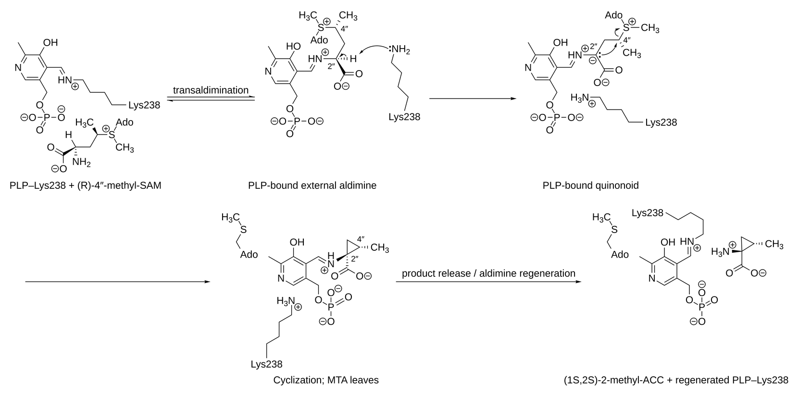](figures/orf30_gpt-6-luna_high.png) |

### 4-オキサロクロトン酸トートメラーゼ

doi:10.1016/j.bioorg.2007.08.003。参照：Scheme 2。

| モデル | 時間（m:ss） | 検査 | 判定 | PARTIAL・FAIL の理由 | Claude のトークン数（入力 + 出力） | Codex のトークン数（合計） | Claude の API 費用 | 図 |
|---|---:|---|---|---|---:|---:|---:|---|
| Sonnet 5.5 high | 2:35 | 47/47 | PARTIAL | 右上のジエノラート中間体の C2=C3 が、論文の Scheme 2 と異なる幾何で描かれています。 | 583,169 | — | $0.41 | [](figures/fourot_sonnet_high.png) |
| Haiku 5.5 high | 5:37 | 48/48 | PARTIAL | 中間体の C2=C3 の立体配置が Scheme 2 と逆のため、修正が必要です。 | 1,312,488 | — | $0.14 | [](figures/fourot_haiku_high.png) |
| Sol 6.2 high | 4:27 | 48/48 | PASS | — | — | 101,764 | — | [](figures/fourot_gpt-6.2-sol_high.png) |
| Luna 6 high | 3:08 | 46/46 | FAIL | 全3パネルでC5と末端カルボキシラートの間にCH₂が1個余分にあり、論文の6炭素骨格が7炭素になっています。 | — | 56,685 | — | [](figures/fourot_gpt-6-luna_high.png) |

### ハロアルコールデハロゲナーゼ HheC

doi:10.1021/ct8000443。参照：Scheme 2。

| モデル | 時間（m:ss） | 検査 | 判定 | PARTIAL・FAIL の理由 | Claude のトークン数（入力 + 出力） | Codex のトークン数（合計） | Claude の API 費用 | 図 |
|---|---:|---|---|---|---:|---:|---:|---|
| Sonnet 5.5 high | 4:51 | 44/44 | PARTIAL | 協奏的な閉環と塩化物の脱離は読み取れますが、左パネルの巻矢印2本は始点が Scheme 2 の酸素原子から O–H 結合に変わっており、原著の機構図として使うには修正が必要です。 | 989,179 | — | $0.57 | [](figures/hhec_sonnet_high.png) |
| Haiku 5.5 high | 5:07 | 44/44 | PASS | — | 1,625,244 | — | $0.11 | [](figures/hhec_haiku_high.png) |
| Sol 6.2 high | 5:38 | 44/44 | PASS | — | — | 67,026 | — | [](figures/hhec_gpt-6.2-sol_high.png) |
| Luna 6 high | 3:10 | 44/44 | PASS | — | — | 54,229 | — | [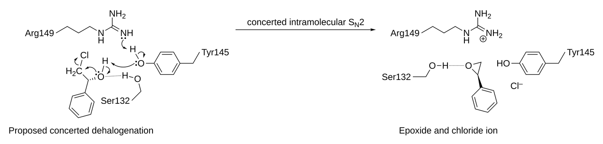](figures/hhec_gpt-6-luna_high.png) |

### SET7/9

doi:10.1002/jcc.21458。参照：Scheme 1 と本文。

| モデル | 時間（m:ss） | 検査 | 判定 | PARTIAL・FAIL の理由 | Claude のトークン数（入力 + 出力） | Codex のトークン数（合計） | Claude の API 費用 | 図 |
|---|---:|---|---|---|---:|---:|---:|---|
| Sonnet 5.5 high | 1:27 | 44/44 | PASS | — | 555,179 | — | $0.32 | [](figures/set79_sonnet_high.png) |
| Haiku 5.5 high | 1:35 | 45/45 | PASS | — | 841,556 | — | $0.03 | [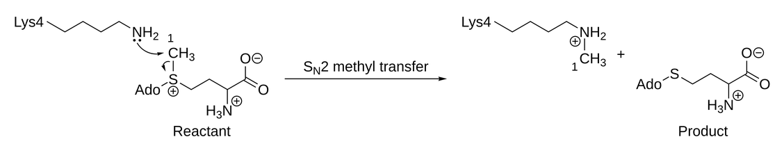](figures/set79_haiku_high.png) |
| Sol 6.2 high | 2:51 | 44/44 | PASS | — | — | 91,241 | — | [](figures/set79_gpt-6.2-sol_high.png) |
| Luna 6 high | 1:51 | 44/44 | PARTIAL | SET7/9 のメチル転移は正しく描かれ、描画検査にも合格していますが、反応するリシンが Lys4 と明記されていません。 | — | 30,786 | — | [](figures/set79_gpt-6-luna_high.png) |

### コリスミ酸ムターゼ

doi:10.1039/b313759g。参照：Fig. 1。

| モデル | 時間（m:ss） | 検査 | 判定 | PARTIAL・FAIL の理由 | Claude のトークン数（入力 + 出力） | Codex のトークン数（合計） | Claude の API 費用 | 図 |
|---|---:|---|---|---|---:|---:|---:|---|
| Sonnet 5.5 high | 4:57 | 46/46 | PASS | — | 963,344 | — | $0.47 | [](figures/cm_sonnet_high.png) |
| Haiku 5.5 high | 7:01 | 46/46 | PARTIAL | Claisen 転位は正しく読めますが、左の Arg7 の水素結合 2 本は、論文では別々の窒素から供与されるところを、図では同じ窒素から供与しています。 | 2,869,527 | — | $0.27 | [](figures/cm_haiku_high.png) |
| Sol 6.2 high | 3:12 | 41/41 | PASS | — | — | 60,937 | — | [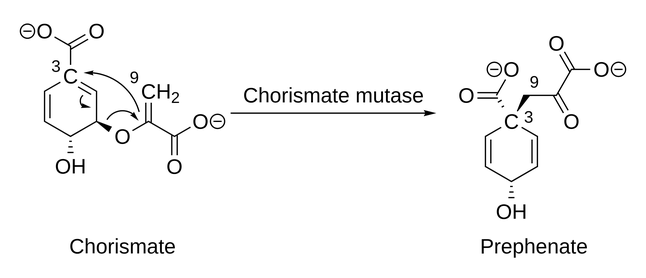](figures/cm_gpt-6.2-sol_high.png) |
| Luna 6 high | 4:41 | 41/41 | PARTIAL | 一段階のクライゼン転位を示す図として使えますが、基質と生成物の立体配置が省略されています。 | — | 82,788 | — | [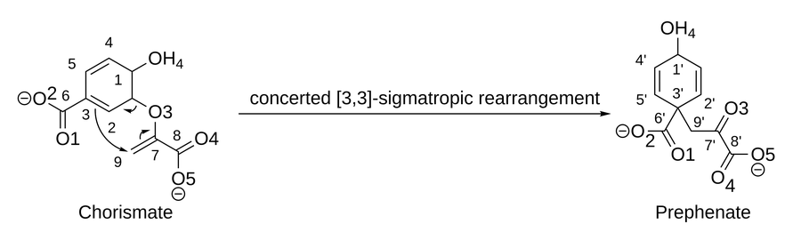](figures/cm_gpt-6-luna_high.png) |

### コリスミ酸ムターゼ（遷移状態つき）

doi:10.1039/b313759g。参照：Fig. 1（prompt で遷移状態の描画を指定）。

| モデル | 時間（m:ss） | 検査 | 判定 | PARTIAL・FAIL の理由 | Claude のトークン数（入力 + 出力） | Codex のトークン数（合計） | Claude の API 費用 | 図 |
|---|---:|---|---|---|---:|---:|---:|---|
| Sonnet 5.5 high | 2:28 | 49/49 | PARTIAL | 形成結合の炭素番号が論文と異なるため、論文と直接照合できる機構図にするには番号の修正が必要です。 | 759,300 | — | $0.49 | [](figures/cmts_sonnet_high.png) |
| Haiku 5.5 high | 6:01 | 44/44 | PARTIAL | 反応の結合変化と遷移状態は正しく描かれていますが、切断されるC–O3結合の炭素に、論文では別の炭素を指す「5」が付いています。 | 1,819,727 | — | $0.16 | [](figures/cmts_haiku_high.png) |
| Sol 6.2 high | 6:55 | 49/49 | PASS | — | — | 100,066 | — | [](figures/cmts_gpt-6.2-sol_high.png) |
| Luna 6 high | 8:23 | 38/39 | FAIL | 基質と生成物の立体配置が論文図と異なり、遷移状態の結合表記とラベル配置にも不備があります。 | — | 97,375 | — | [](figures/cmts_gpt-6-luna_high.png) |

### キモトリプシン

教科書の反応機構を書き起こしたもの（参照論文なし）。

| モデル | 時間（m:ss） | 検査 | 判定 | PARTIAL・FAIL の理由 | Claude のトークン数（入力 + 出力） | Codex のトークン数（合計） | Claude の API 費用 | 図 |
|---|---:|---|---|---|---:|---:|---:|---|
| Sonnet 5.5 high | 3:44 | 44/44 | PASS | — | 542,838 | — | $0.53 | [](figures/chymo_sonnet_high.png) |
| Haiku 5.5 high | 5:58 | 44/44 | PASS | — | 824,495 | — | $0.05 | [](figures/chymo_haiku_high.png) |
| Sol 6.2 high | 8:25 | 44/44 | PASS | — | — | 108,864 | — | [](figures/chymo_gpt-6.2-sol_high.png) |
| Luna 6 high | 4:22 | 48/48 | PASS | — | — | 46,071 | — | [](figures/chymo_gpt-6-luna_high.png) |

### アルドール縮合

教科書の反応機構を書き起こしたもの（参照論文なし）。

| モデル | 時間（m:ss） | 検査 | 判定 | PARTIAL・FAIL の理由 | Claude のトークン数（入力 + 出力） | Codex のトークン数（合計） | Claude の API 費用 | 図 |
|---|---:|---|---|---|---:|---:|---:|---|
| Sonnet 5.5 high | 1:47 | 39/39 | PASS | — | 321,974 | — | $0.28 | [](figures/aldol_sonnet_high.png) |
| Haiku 5.5 high | 4:00 | 39/39 | PASS | — | 573,081 | — | $0.04 | [](figures/aldol_haiku_high.png) |
| Sol 6.2 high | 2:18 | 39/39 | PASS | — | — | 41,088 | — | [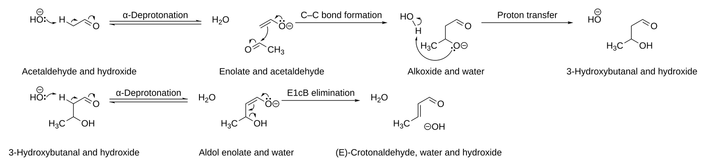](figures/aldol_gpt-6.2-sol_high.png) |
| Luna 6 high | 6:44 | 44/44 | PASS | — | — | 51,954 | — | [](figures/aldol_gpt-6-luna_high.png) |

### プロペンへの HBr のラジカル付加

教科書の反応機構を書き起こしたもの（参照論文なし）。

| モデル | 時間（m:ss） | 検査 | 判定 | PARTIAL・FAIL の理由 | Claude のトークン数（入力 + 出力） | Codex のトークン数（合計） | Claude の API 費用 | 図 |
|---|---:|---|---|---|---:|---:|---:|---|
| Sonnet 5.5 high | 1:30 | 31/31 | PASS | — | 364,738 | — | $0.26 | [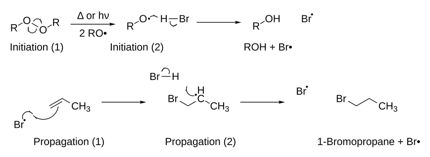](figures/radical_sonnet_high.png) |
| Haiku 5.5 high | 2:45 | 31/31 | PARTIAL | 反応機構は正しく描かれていますが、伝播1で片羽矢印の尾が二重結合から離れ、電子の出所が読み取りにくいです。 | 437,662 | — | $0.03 | [](figures/radical_haiku_high.png) |
| Sol 6.2 high | 1:41 | 32/32 | PASS | — | — | 35,506 | — | [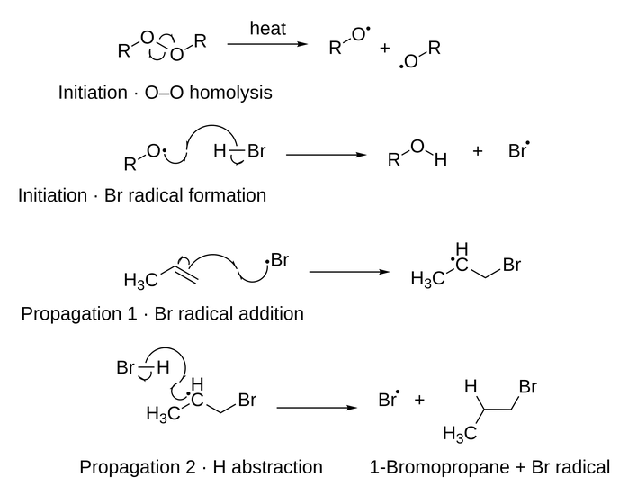](figures/radical_gpt-6.2-sol_high.png) |
| Luna 6 high | 2:12 | 35/35 | PARTIAL | 過酸化水素の均等開裂で生じる OH• が図では 1 個分不足し、開始段階の水素移動を示す矢印が H 原子から離れた位置で止まっています。 | — | 24,000 | — | [](figures/radical_gpt-6-luna_high.png) |

### 炭酸脱水酵素 II

教科書の反応機構を書き起こしたもの（参照論文なし）。

| モデル | 時間（m:ss） | 検査 | 判定 | PARTIAL・FAIL の理由 | Claude のトークン数（入力 + 出力） | Codex のトークン数（合計） | Claude の API 費用 | 図 |
|---|---:|---|---|---|---:|---:|---:|---|
| Sonnet 5.5 high | 2:28 | 44/44 | PASS | — | 328,431 | — | $0.26 | [](figures/metal_sonnet_high.png) |
| Haiku 5.5 high | 4:16 | 43/43 | PARTIAL | 炭酸脱水酵素 II の機構と電荷は基準に合っていますが、配位子交換の反応矢印が上段の中間体から離れており、段をまたぐ反応順が追いにくいです。 | 1,024,577 | — | $0.05 | [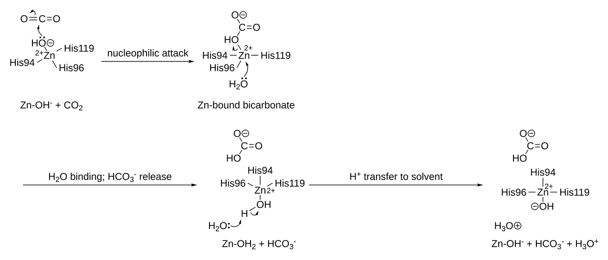](figures/metal_haiku_high.png) |
| Sol 6.2 high | 4:17 | 44/44 | PARTIAL | 反応機構は正しいですが、第3パネルで巻矢印が W1 の O–H 結合を横切り、電子対の出所が読み取りにくくなっています。 | — | 56,715 | — | [](figures/metal_gpt-6.2-sol_high.png) |
| Luna 6 high | 4:29 | 48/48 | PASS | — | — | 27,424 | — | [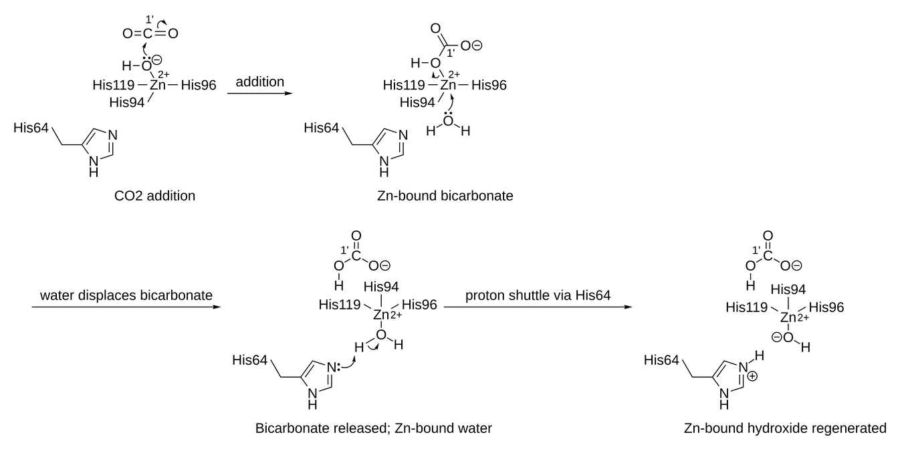](figures/metal_gpt-6-luna_high.png) |
