# ベンチマーク

[English](README.md) | [日本語](README.ja.md)

4 つのモデル（effort は high）に 11 問の反応機構を描かせました（計 44 回）。Claude のモデル（Sonnet 5.5・Haiku 5.5）は Claude Code で、GPT のモデル（Sol 6.1・Luna 6）は Codex CLI で動かしました。結果は **PASS 27、PARTIAL 14、FAIL 3** で、描画の自動検査には 44 回すべてが合格しました。以下に prompt、結果、各回の出力図を示します。

## 条件と prompt

各回は、skill のフォルダー（`./reaction-draw/`）と、論文の問題では対象論文（`./paper/`、Orf30 は Supporting Information を含む）のみを配置したディレクトリで開始しました。Claude Code は `claude -p --safe-mode`、Codex CLI は空の `HOME` 環境で実行しました。各エージェントには以下の prompt を 1 回だけ渡し、追加の指示は与えていません。全 44 回は並列に実行しました。

論文の問題（`<DOI>` は論文の DOI）：

```text
Draw the enzyme reaction mechanism proposed in the paper in ./paper/ (doi:<DOI>) as a curved-arrow figure. Use the skill in ./reaction-draw/. Work in this directory and save the figure in ./out/.
```

コリスミ酸ムターゼ（遷移状態つき）：

```text
Draw the enzyme reaction mechanism proposed in the paper in ./paper/ (doi:<DOI>), including its transition state, as a curved-arrow figure. Use the skill in ./reaction-draw/. Work in this directory and save the figure in ./out/.
```

教科書の問題（`<TOPIC>` は下記）：

```text
Draw the reaction mechanism of <TOPIC> as a curved-arrow figure. Use the skill in ./reaction-draw/. Work in this directory and save the figure in ./out/.
```

- Chymotrypsin: the hydrolysis of a peptide bond by chymotrypsin (catalytic triad Ser195, His57, Asp102; oxyanion hole), acylation and deacylation,
- Aldol condensation: the base-catalysed (hydroxide) aldol condensation of two acetaldehyde molecules to crotonaldehyde
- Radical addition: the peroxide-initiated radical addition of HBr to propene giving 1-bromopropane (initiation and the two propagation steps)
- Carbonic anhydrase: the hydration of CO2 by carbonic anhydrase II (Zn2+ bound to His94, His96 and His119; the zinc-bound hydroxide attacks CO2; bicarbonate release and regeneration of the zinc-bound hydroxide)

## 採点

描画の自動検査とは別に、独立した採点役として GPT Sol 6.1 xhigh を用い、各図を論文の反応機構図（教科書の問題では教科書の機構を書き起こしたもの）と比較して、化学的な正しさ、skill の使い方、読みやすさを評価しました。

- PASS：参照元の反応機構を十分に正しく表しており、描画の自動検査にすべて合格し、視覚的にも読みやすい。
- PARTIAL：図として成立しているが、化学的な記述に一部不足があるか、描画の自動検査に不合格項目がある。
- FAIL：化学的に誤っている、重要な反応段階が欠けている、または図が出力されていない。

以下に示す判定および PARTIAL・FAIL の理由は、この採点役による評価結果です。

## モデルごとの要約

各行は、各モデルで 11 問を 1 回ずつ（effort は high）実行した結果の集計です。時間、トークン数、費用は 1 回あたりの中央値です。Claude の入力トークン数は通常入力・キャッシュ書き込み・キャッシュ読み込みの合計で、出力トークン数には思考トークンを含みます。費用は定価に基づく米ドルの概算です。Codex は CLI が出力する `tokens used` の合計値のみを記録しました。Claude と Codex ではトークンの集計方法が異なるため、数値を直接比較することはできません。

| モデル | 回数 | PASS | PARTIAL | FAIL | 時間の中央値（m:ss） | Claude のトークン数の中央値（入力 + 出力） | Codex のトークン数の中央値（合計） | Claude の API 費用の中央値 |
|---|---:|---:|---:|---:|---:|---:|---:|---:|
| Sonnet 5.5 high | 11 | 9 | 2 | 0 | 11:48 | 1,351,590 | — | $0.64 |
| Haiku 5.5 high | 11 | 3 | 8 | 0 | 7:25 | 1,268,582 | — | $0.04 |
| Sol 6.1 high | 11 | 10 | 1 | 0 | 7:55 | — | 87,662 | — |
| Luna 6 high | 11 | 5 | 3 | 3 | 11:30 | — | 87,925 | — |

## 問題ごとの図

時間は経過時間、`検査` は最終出力図に対する自動検査のスコアです。図をクリックすると 150 dpi の画像が開きます。

### BezA

doi:10.1002/anie.202111217。参照：Figure 4。

| モデル | 時間（m:ss） | 検査 | 判定 | PARTIAL・FAIL の理由 | Claude のトークン数（入力 + 出力） | Codex のトークン数（合計） | Claude の API 費用 | 図 |
|---|---:|---|---|---|---:|---:|---:|---|
| Sonnet 5.5 high | 1:37 | 43/43 | PASS | — | 901,233 | — | $0.38 | [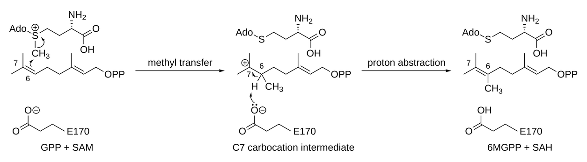](figures/beza_sonnet_high.png) |
| Haiku 5.5 high | 1:32 | 43/43 | PASS | — | 493,714 | — | $0.02 | [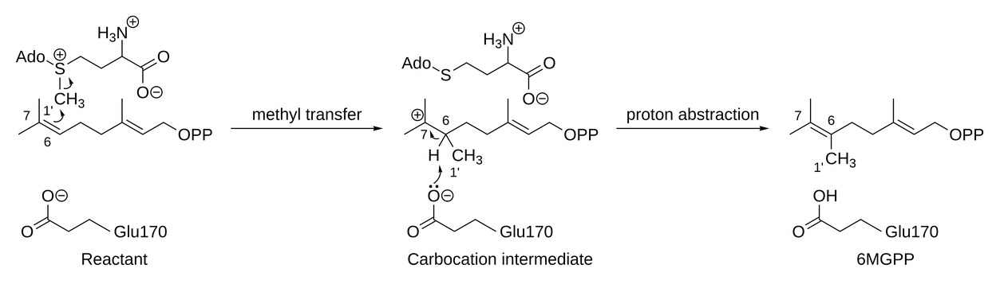](figures/beza_haiku_high.png) |
| Sol 6.1 high | 2:06 | 43/43 | PASS | — | — | 57,221 | — | [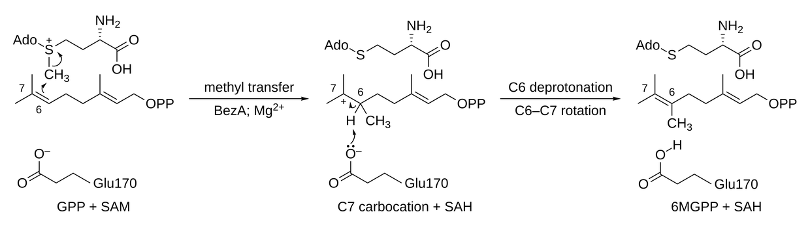](figures/beza_gpt-6.1-sol_high.png) |
| Luna 6 high | 1:55 | 43/43 | PASS | — | — | 42,336 | — | [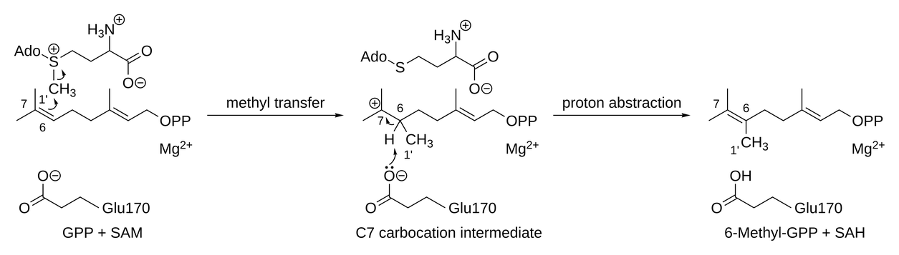](figures/beza_gpt-6-luna_high.png) |

### Orf30

doi:10.1021/jacs.6c13085。参照：Figure S14 と本文。

| モデル | 時間（m:ss） | 検査 | 判定 | PARTIAL・FAIL の理由 | Claude のトークン数（入力 + 出力） | Codex のトークン数（合計） | Claude の API 費用 | 図 |
|---|---:|---|---|---|---:|---:|---:|---|
| Sonnet 5.5 high | 17:01 | 45/45 | PARTIAL | 直接環化は正しく描けていますが、酵素再生の巻矢印とプロトン移動が不足しています。 | 2,870,454 | — | $1.04 | [](figures/orf30_sonnet_high.png) |
| Haiku 5.5 high | 17:33 | 44/44 | PARTIAL | 環化と生成物の立体化学は一致していますが、補酵素のプロトン化状態と触媒再生に化学上の不足があります。 | 2,294,320 | — | $0.13 | [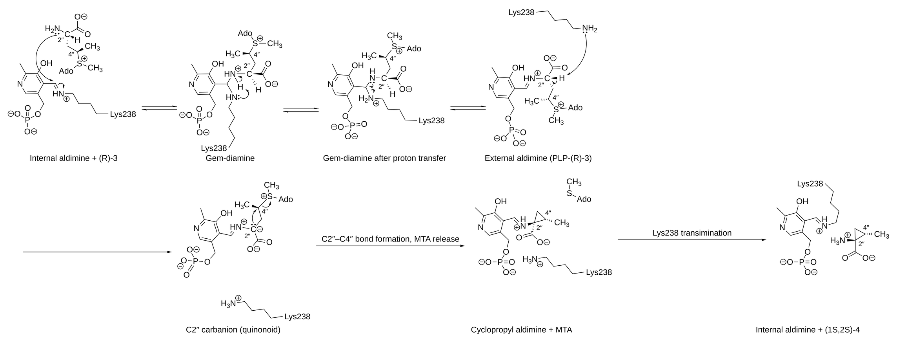](figures/orf30_haiku_high.png) |
| Sol 6.1 high | 13:51 | 44/44 | PARTIAL | 反応経路と立体配置は正しいものの、脱プロトン化の電子移動を示す小矢印が判読しにくく、修正が必要です。 | — | 119,243 | — | [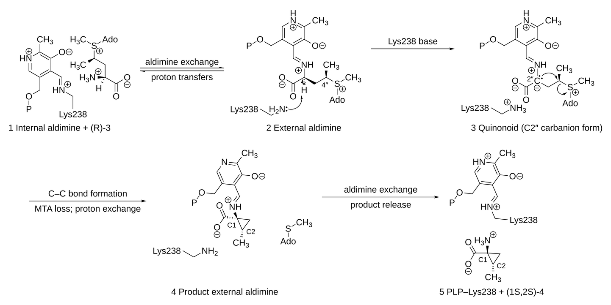](figures/orf30_gpt-6.1-sol_high.png) |
| Luna 6 high | 12:17 | 40/40 | FAIL | 環化後の構造が誤っており、論文の反応機構図として使用できません。 | — | 95,838 | — | [](figures/orf30_gpt-6-luna_high.png) |

### 4-オキサロクロトン酸トートメラーゼ

doi:10.1016/j.bioorg.2007.08.003。参照：Scheme 2。

| モデル | 時間（m:ss） | 検査 | 判定 | PARTIAL・FAIL の理由 | Claude のトークン数（入力 + 出力） | Codex のトークン数（合計） | Claude の API 費用 | 図 |
|---|---:|---|---|---|---:|---:|---:|---|
| Sonnet 5.5 high | 11:48 | 44/44 | PASS | — | 1,076,833 | — | $0.50 | [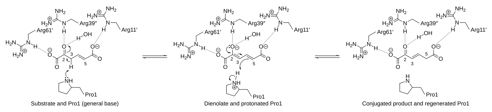](figures/fourot_sonnet_high.png) |
| Haiku 5.5 high | 18:17 | 41/41 | PASS | — | 4,048,219 | — | $0.21 | [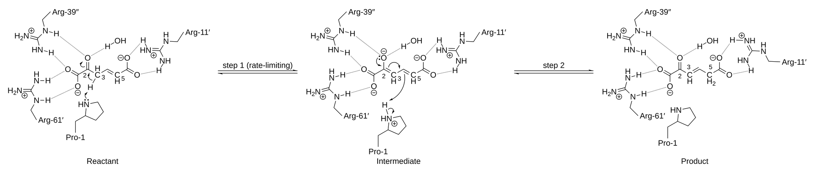](figures/fourot_haiku_high.png) |
| Sol 6.1 high | 8:47 | 45/45 | PASS | — | — | 87,662 | — | [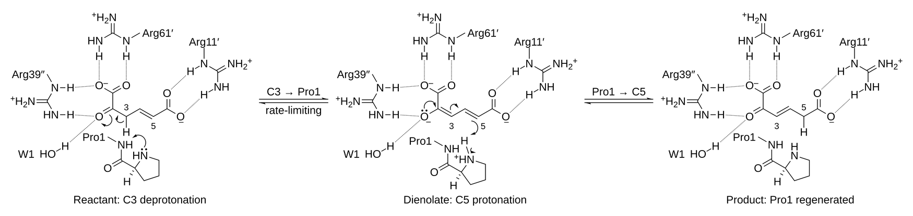](figures/fourot_gpt-6.1-sol_high.png) |
| Luna 6 high | 3:29 | 43/43 | PASS | — | — | 52,722 | — | [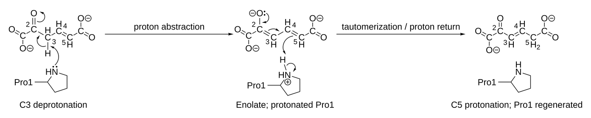](figures/fourot_gpt-6-luna_high.png) |

### ハロアルコールデハロゲナーゼ HheC

doi:10.1021/ct8000443。参照：Scheme 2。

| モデル | 時間（m:ss） | 検査 | 判定 | PARTIAL・FAIL の理由 | Claude のトークン数（入力 + 出力） | Codex のトークン数（合計） | Claude の API 費用 | 図 |
|---|---:|---|---|---|---:|---:|---:|---|
| Sonnet 5.5 high | 24:10 | 41/41 | PASS | — | 1,943,556 | — | $0.71 | [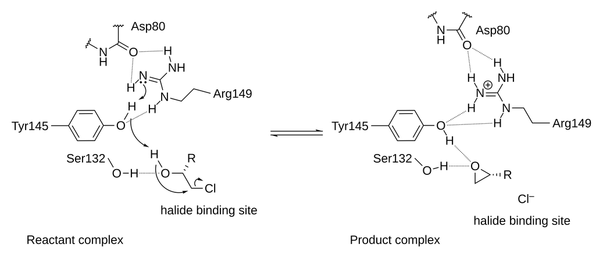](figures/hhec_sonnet_high.png) |
| Haiku 5.5 high | 16:12 | 42/42 | PARTIAL | 主反応は正しいですが、Asp80 の接続位置と Ser132 の水素結合が原図と異なり、修正が必要です。 | 2,179,714 | — | $0.10 | [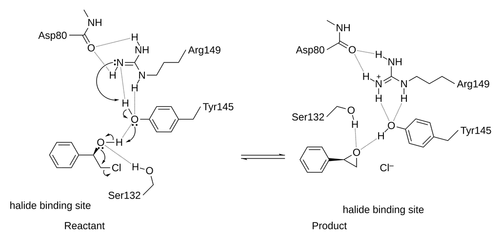](figures/hhec_haiku_high.png) |
| Sol 6.1 high | 7:55 | 42/42 | PASS | — | — | 75,669 | — | [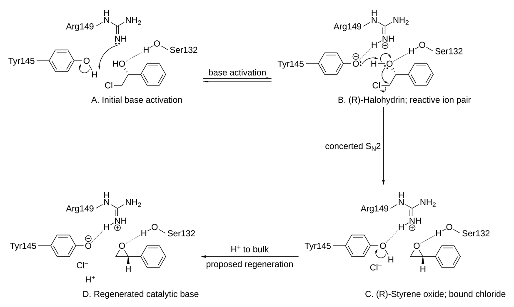](figures/hhec_gpt-6.1-sol_high.png) |
| Luna 6 high | 45:36 | 44/44 | FAIL | 環化の流れは読み取れますが、反応に関与する Arg149 が窒素ラジカルとして描かれており、水素数も一致しません。 | — | 162,931 | — | [](figures/hhec_gpt-6-luna_high.png) |

### SET7/9

doi:10.1002/jcc.21458。参照：Scheme 1 と本文。

| モデル | 時間（m:ss） | 検査 | 判定 | PARTIAL・FAIL の理由 | Claude のトークン数（入力 + 出力） | Codex のトークン数（合計） | Claude の API 費用 | 図 |
|---|---:|---|---|---|---:|---:|---:|---|
| Sonnet 5.5 high | 1:11 | 37/37 | PASS | — | 496,793 | — | $0.27 | [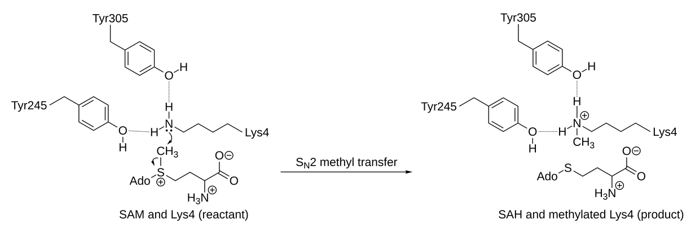](figures/set79_sonnet_high.png) |
| Haiku 5.5 high | 1:25 | 41/41 | PASS | — | 840,433 | — | $0.02 | [](figures/set79_haiku_high.png) |
| Sol 6.1 high | 2:55 | 38/38 | PASS | — | — | 47,898 | — | [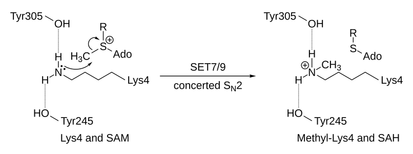](figures/set79_gpt-6.1-sol_high.png) |
| Luna 6 high | 16:23 | 37/37 | PASS | — | — | 129,420 | — | [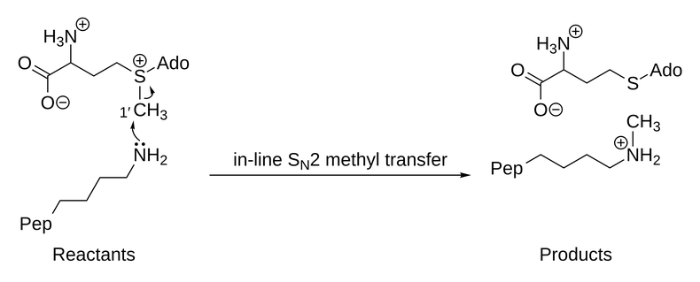](figures/set79_gpt-6-luna_high.png) |

### コリスミ酸ムターゼ

doi:10.1039/b313759g。参照：Fig. 1。

| モデル | 時間（m:ss） | 検査 | 判定 | PARTIAL・FAIL の理由 | Claude のトークン数（入力 + 出力） | Codex のトークン数（合計） | Claude の API 費用 | 図 |
|---|---:|---|---|---|---:|---:|---:|---|
| Sonnet 5.5 high | 11:51 | 43/43 | PASS | — | 1,351,590 | — | $0.64 | [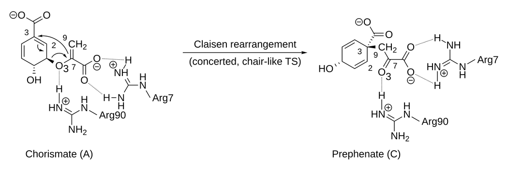](figures/cm_sonnet_high.png) |
| Haiku 5.5 high | 7:25 | 39/39 | PARTIAL | 反応の骨格・電荷・電子移動は正しいですが、生成物の相対立体配置が省略されています。 | 1,268,582 | — | $0.04 | [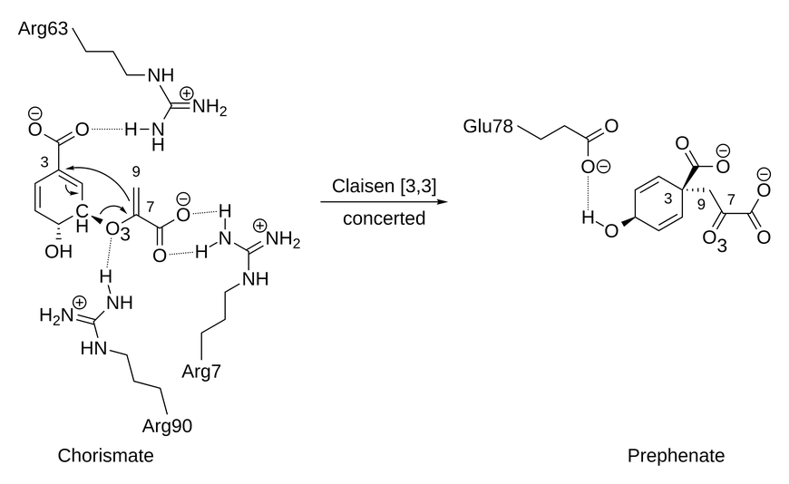](figures/cm_haiku_high.png) |
| Sol 6.1 high | 5:50 | 39/39 | PASS | — | — | 88,591 | — | [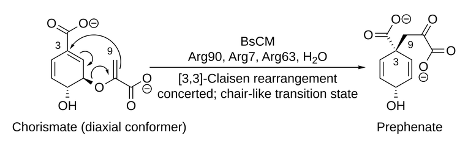](figures/cm_gpt-6.1-sol_high.png) |
| Luna 6 high | 9:45 | 35/35 | PARTIAL | 反応の結合変化と電荷は正しいですが、原著にある立体配置が欠落しており、検査記録にも不一致があります。 | — | 77,103 | — | [](figures/cm_gpt-6-luna_high.png) |

### コリスミ酸ムターゼ（遷移状態つき）

doi:10.1039/b313759g。参照：Fig. 1（prompt で遷移状態の描画を指定）。

| モデル | 時間（m:ss） | 検査 | 判定 | PARTIAL・FAIL の理由 | Claude のトークン数（入力 + 出力） | Codex のトークン数（合計） | Claude の API 費用 | 図 |
|---|---:|---|---|---|---:|---:|---:|---|
| Sonnet 5.5 high | 15:01 | 46/46 | PASS | — | 3,867,163 | — | $1.17 | [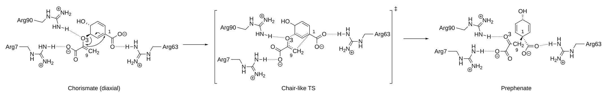](figures/cmts_sonnet_high.png) |
| Haiku 5.5 high | 11:33 | 42/42 | PARTIAL | 反応と遷移状態は正しく読み取れますが、生成物の相対立体配置が省略されています。 | 3,414,681 | — | $0.28 | [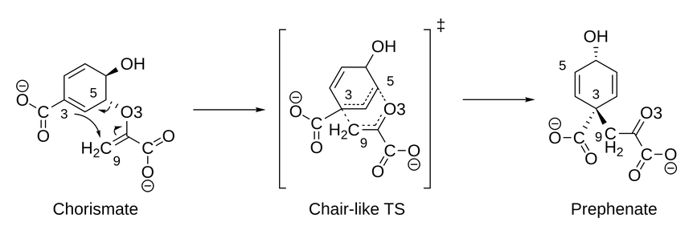](figures/cmts_haiku_high.png) |
| Sol 6.1 high | 12:27 | 46/46 | PASS | — | — | 105,127 | — | [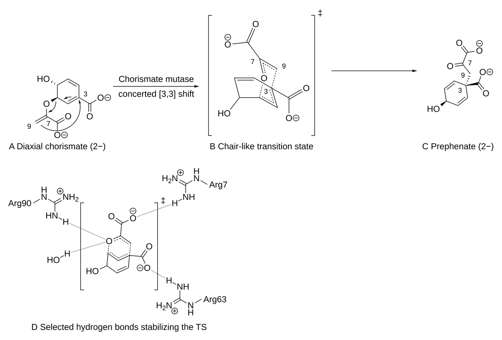](figures/cmts_gpt-6.1-sol_high.png) |
| Luna 6 high | 14:09 | 38/38 | PARTIAL | 転位の結合変化は正しいですが、反応物の立体配置が省略されており、遷移状態で結合の交差が残っています。 | — | 92,975 | — | [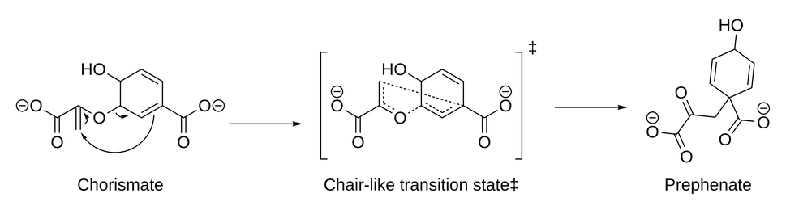](figures/cmts_gpt-6-luna_high.png) |

### キモトリプシン

教科書の反応機構を書き起こしたもの（参照論文なし）。

| モデル | 時間（m:ss） | 検査 | 判定 | PARTIAL・FAIL の理由 | Claude のトークン数（入力 + 出力） | Codex のトークン数（合計） | Claude の API 費用 | 図 |
|---|---:|---|---|---|---:|---:|---:|---|
| Sonnet 5.5 high | 56:05 | 41/41 | PASS | — | 4,994,935 | — | $1.52 | [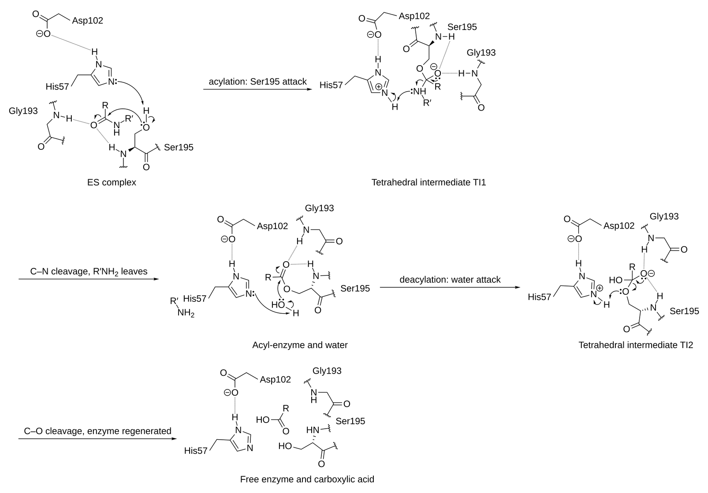](figures/chymo_sonnet_high.png) |
| Haiku 5.5 high | 19:40 | 41/41 | PARTIAL | 主要な 4 段階はそろっていますが、2 箇所のプロトン移動の矢印に修正が必要です。 | 4,358,091 | — | $0.23 | [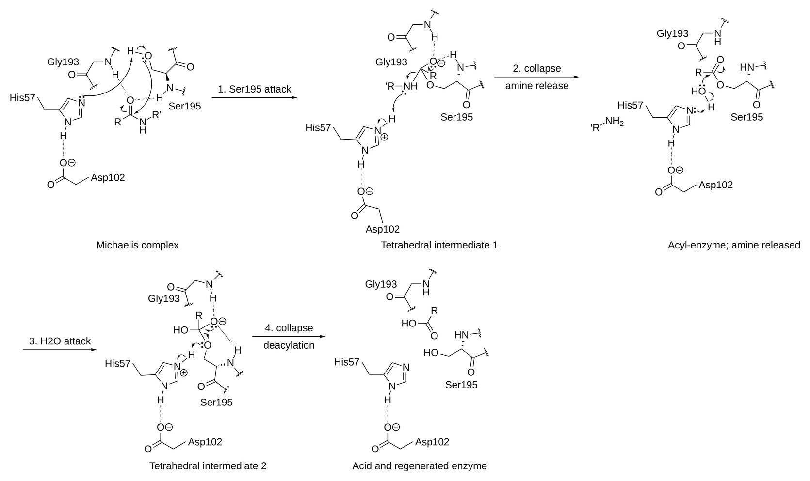](figures/chymo_haiku_high.png) |
| Sol 6.1 high | 13:42 | 41/41 | PASS | — | — | 116,548 | — | [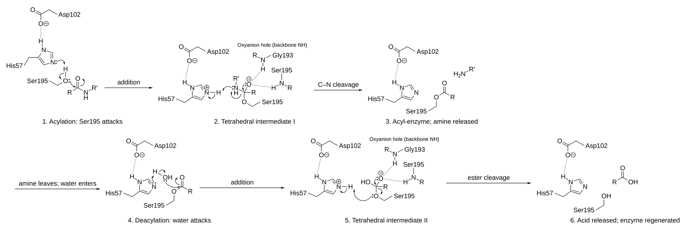](figures/chymo_gpt-6.1-sol_high.png) |
| Luna 6 high | 11:30 | 40/40 | PASS | — | — | 87,925 | — | [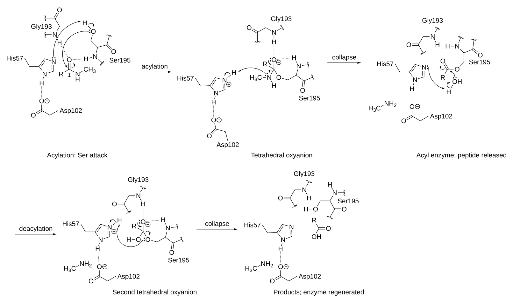](figures/chymo_gpt-6-luna_high.png) |

### アルドール縮合

教科書の反応機構を書き起こしたもの（参照論文なし）。

| モデル | 時間（m:ss） | 検査 | 判定 | PARTIAL・FAIL の理由 | Claude のトークン数（入力 + 出力） | Codex のトークン数（合計） | Claude の API 費用 | 図 |
|---|---:|---|---|---|---:|---:|---:|---|
| Sonnet 5.5 high | 2:31 | 37/37 | PARTIAL | 化学種と生成物は正しいものの、電子対の移動を示す巻矢印が 3 本欠けています。 | 641,349 | — | $0.42 | [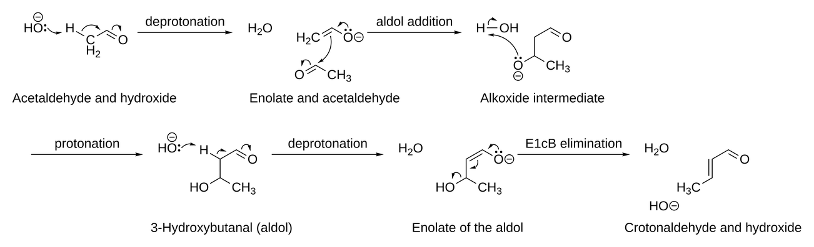](figures/aldol_sonnet_high.png) |
| Haiku 5.5 high | 3:22 | 37/37 | PARTIAL | 反応経路と生成物は正しいですが、付加段階（2）に必要な巻矢印が 1 本欠けています。 | 791,136 | — | $0.04 | [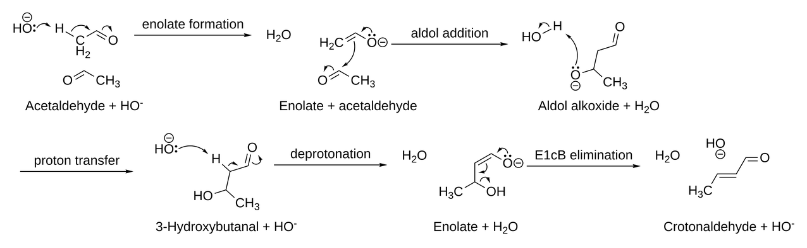](figures/aldol_haiku_high.png) |
| Sol 6.1 high | 4:26 | 37/37 | PASS | — | — | 74,538 | — | [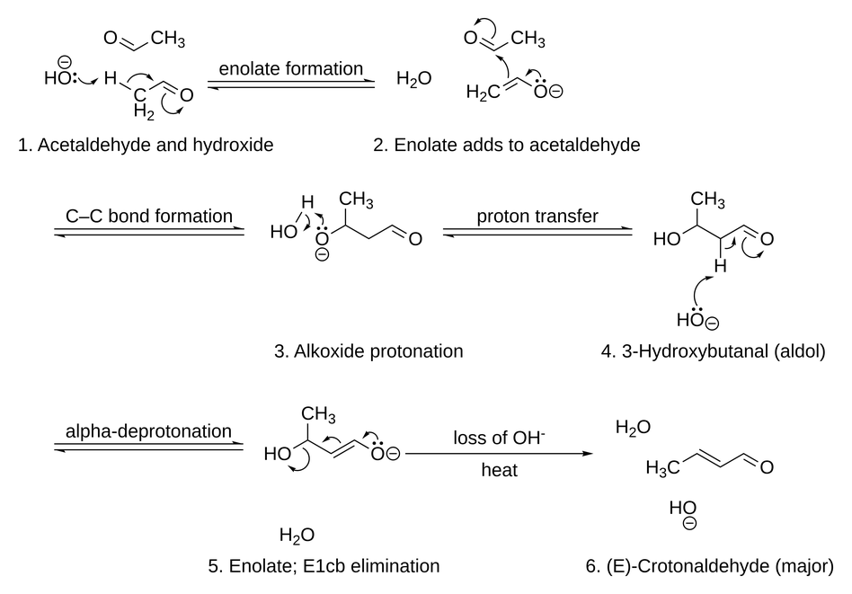](figures/aldol_gpt-6.1-sol_high.png) |
| Luna 6 high | 4:48 | 37/37 | PASS | — | — | 61,179 | — | [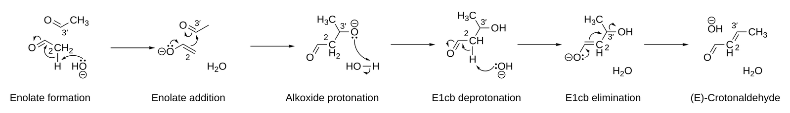](figures/aldol_gpt-6-luna_high.png) |

### プロペンへの HBr のラジカル付加

教科書の反応機構を書き起こしたもの（参照論文なし）。

| モデル | 時間（m:ss） | 検査 | 判定 | PARTIAL・FAIL の理由 | Claude のトークン数（入力 + 出力） | Codex のトークン数（合計） | Claude の API 費用 | 図 |
|---|---:|---|---|---|---:|---:|---:|---|
| Sonnet 5.5 high | 2:15 | 29/29 | PASS | — | 543,737 | — | $0.33 | [](figures/radical_sonnet_high.png) |
| Haiku 5.5 high | 4:46 | 29/29 | PARTIAL | 連鎖反応は正しいですが、過酸化物の均等開裂で生じる「2 RO•」の表示が欠けています。 | 1,118,670 | — | $0.04 | [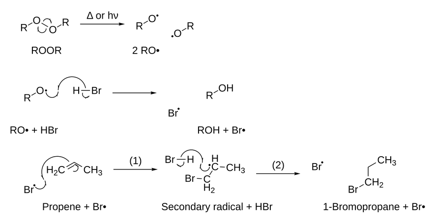](figures/radical_haiku_high.png) |
| Sol 6.1 high | 2:23 | 29/29 | PASS | — | — | 43,751 | — | [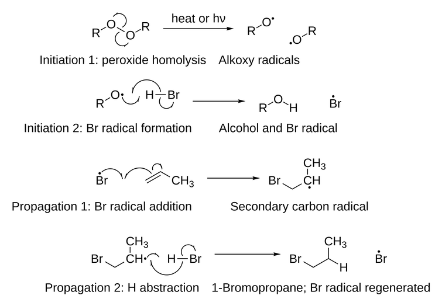](figures/radical_gpt-6.1-sol_high.png) |
| Luna 6 high | 5:52 | 29/29 | PARTIAL | 生成物と連鎖反応の骨格は正しいですが、開始反応の ROH が欠落しており、水素引き抜きの矢印も不明瞭です。 | — | 58,141 | — | [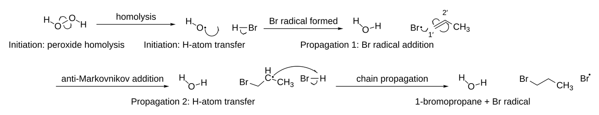](figures/radical_gpt-6-luna_high.png) |

### 炭酸脱水酵素 II

教科書の反応機構を書き起こしたもの（参照論文なし）。

| モデル | 時間（m:ss） | 検査 | 判定 | PARTIAL・FAIL の理由 | Claude のトークン数（入力 + 出力） | Codex のトークン数（合計） | Claude の API 費用 | 図 |
|---|---:|---|---|---|---:|---:|---:|---|
| Sonnet 5.5 high | 9:27 | 41/41 | PASS | — | 1,981,673 | — | $0.70 | [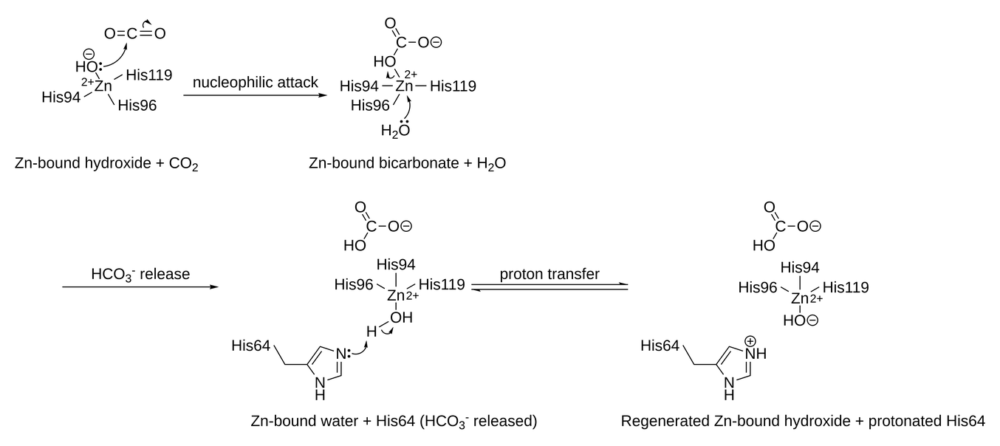](figures/metal_sonnet_high.png) |
| Haiku 5.5 high | 5:52 | 41/41 | PARTIAL | 主要な 3 段階と電子移動は正しいですが、全パネルで His119 の配位窒素が誤っています。 | 883,342 | — | $0.04 | [](figures/metal_haiku_high.png) |
| Sol 6.1 high | 11:02 | 41/41 | PASS | — | — | 95,019 | — | [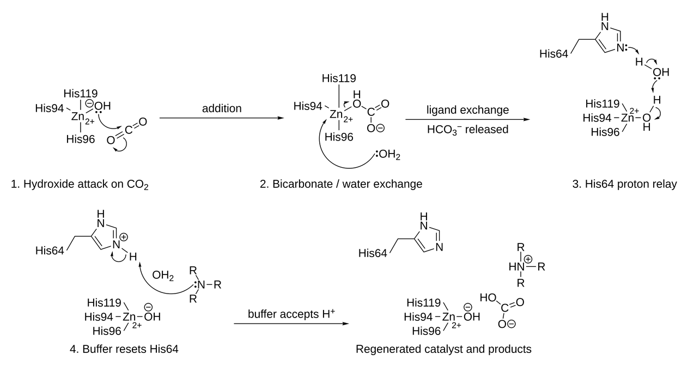](figures/metal_gpt-6.1-sol_high.png) |
| Luna 6 high | 21:07 | 43/43 | FAIL | 必須の反応段階は描かれていますが、反応する水酸化物イオンの水素が欠けており、生成物が炭酸水素イオンではなくラジカルになっています。 | — | 187,955 | — | [](figures/metal_gpt-6-luna_high.png) |
