# Benchmark

[English](README.md) | [日本語](README.ja.md)

Four models were tested at high effort on 11 reaction-mechanism problems (44 runs): two Claude models (Sonnet 5.5 and Haiku 5.5) in Claude Code, and two GPT models (Sol 6.1 and Luna 6) in Codex CLI. All 44 runs passed the automated drawing checks, and independent judging yielded **27 PASS, 14 PARTIAL, and 3 FAIL**.

## Setup and prompts

Each run started in a clean directory containing only the `./reaction-draw/` skill folder and, for paper-based problems, the source paper in `./paper/` (including Supporting Information for Orf30). Claude Code ran with `claude -p --safe-mode`, and Codex CLI ran with an empty `HOME`. Each agent received a single prompt with no additional instructions or follow-up.

Paper problems (6 problems; `<DOI>` is the paper's DOI):

```text
Draw the enzyme reaction mechanism proposed in the paper in ./paper/ (doi:<DOI>) as a curved-arrow figure. Use the skill in ./reaction-draw/. Work in this directory and save the figure in ./out/.
```

Chorismate mutase with its transition state (1 problem):

```text
Draw the enzyme reaction mechanism proposed in the paper in ./paper/ (doi:<DOI>), including its transition state, as a curved-arrow figure. Use the skill in ./reaction-draw/. Work in this directory and save the figure in ./out/.
```

Textbook problems (4 problems; `<TOPIC>` listed below):

```text
Draw the reaction mechanism of <TOPIC> as a curved-arrow figure. Use the skill in ./reaction-draw/. Work in this directory and save the figure in ./out/.
```

- **Chymotrypsin**: the hydrolysis of a peptide bond by chymotrypsin (catalytic triad Ser195, His57, Asp102; oxyanion hole), acylation and deacylation,
- **Aldol condensation**: the base-catalysed (hydroxide) aldol condensation of two acetaldehyde molecules to crotonaldehyde
- **Radical addition**: the peroxide-initiated radical addition of HBr to propene giving 1-bromopropane (initiation and the two propagation steps)
- **Carbonic anhydrase**: the hydration of CO2 by carbonic anhydrase II (Zn2+ bound to His94, His96 and His119; the zinc-bound hydroxide attacks CO2; bicarbonate release and regeneration of the zinc-bound hydroxide)

## Judging

In addition to the automated drawing checks, an independent GPT Sol 6.1 xhigh judge evaluated each figure against the paper's mechanism figure (or a written reference mechanism for textbook problems) for chemical accuracy, skill usage, and readability:

- **PASS**: Chemically accurate and complete enough to represent the reference mechanism, passes all drawing checks, and is visually readable.
- **PARTIAL**: Usable figure with a specific chemistry gap or failed drawing check.
- **FAIL**: Incorrect chemistry, a missing key step, or no output figure.

The verdicts below are taken from the judge's saved assessments, with reasons for PARTIAL and FAIL translated from those outputs.

## Summary by model

Each row covers 11 high-effort runs (one per problem); times, token counts, and costs are per-run medians. For Claude, token counts sum all input (uncached, cache writes, and cache reads) and output (including thinking) tokens, and costs are list-price USD estimates. For Codex, only the CLI-reported total `tokens used` was recorded. Because Claude and Codex count tokens differently, their token counts are not directly comparable.

| Model | Runs | PASS | PARTIAL | FAIL | Median time (m:ss) | Median Claude tokens (in + out) | Median Codex tokens (total) | Median Claude API cost |
|---|---:|---:|---:|---:|---:|---:|---:|---:|
| Sonnet 5.5 high | 11 | 9 | 2 | 0 | 11:48 | 1,351,590 | — | $0.64 |
| Haiku 5.5 high | 11 | 3 | 8 | 0 | 7:25 | 1,268,582 | — | $0.04 |
| Sol 6.1 high | 11 | 10 | 1 | 0 | 7:55 | — | 87,662 | — |
| Luna 6 high | 11 | 5 | 3 | 3 | 11:30 | — | 87,925 | — |

## Figures by problem

Times reflect elapsed wall-clock time, and `Checks` is the automated check score of the final drawing. Click any preview to open the 150 dpi image.

### BezA

doi:10.1002/anie.202111217. Reference: Figure 4.

| Model | Time (m:ss) | Checks | Verdict | Reason for PARTIAL / FAIL | Claude tokens (in + out) | Codex tokens (total) | Claude API cost | Figure |
|---|---:|---|---|---|---:|---:|---:|---|
| Sonnet 5.5 high | 1:37 | 43/43 | PASS | — | 901,233 | — | $0.38 | [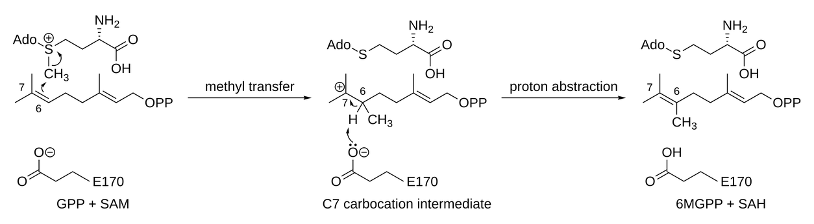](figures/beza_sonnet_high.png) |
| Haiku 5.5 high | 1:32 | 43/43 | PASS | — | 493,714 | — | $0.02 | [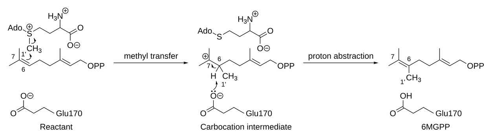](figures/beza_haiku_high.png) |
| Sol 6.1 high | 2:06 | 43/43 | PASS | — | — | 57,221 | — | [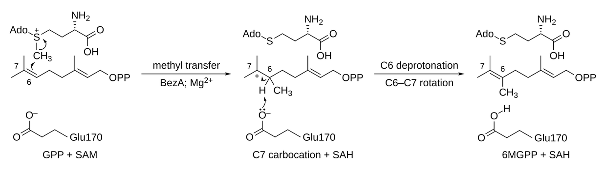](figures/beza_gpt-6.1-sol_high.png) |
| Luna 6 high | 1:55 | 43/43 | PASS | — | — | 42,336 | — | [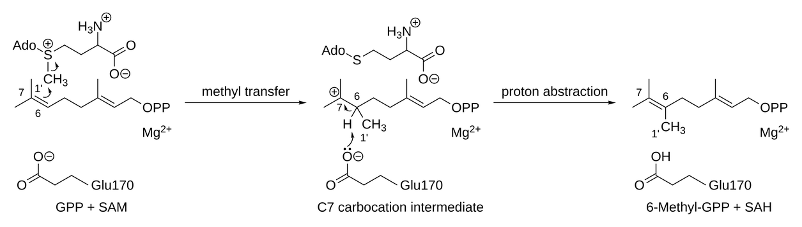](figures/beza_gpt-6-luna_high.png) |

### Orf30

doi:10.1021/jacs.6c13085. Reference: Figure S14 and main text.

| Model | Time (m:ss) | Checks | Verdict | Reason for PARTIAL / FAIL | Claude tokens (in + out) | Codex tokens (total) | Claude API cost | Figure |
|---|---:|---|---|---|---:|---:|---:|---|
| Sonnet 5.5 high | 17:01 | 45/45 | PARTIAL | Direct cyclization is correct, but curved arrows and proton transfers for enzyme regeneration are missing. | 2,870,454 | — | $1.04 | [](figures/orf30_sonnet_high.png) |
| Haiku 5.5 high | 17:33 | 44/44 | PARTIAL | Cyclization and product stereochemistry are correct, but the cofactor protonation state and catalyst regeneration are incomplete. | 2,294,320 | — | $0.13 | [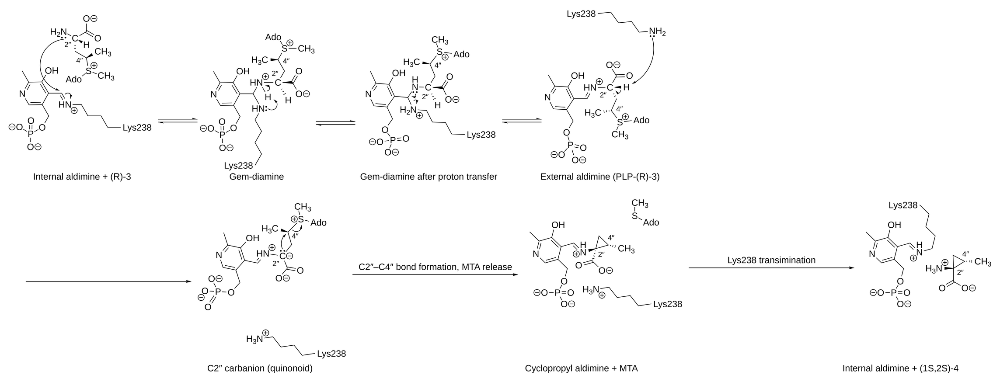](figures/orf30_haiku_high.png) |
| Sol 6.1 high | 13:51 | 44/44 | PARTIAL | Pathway and configuration are correct, but small deprotonation arrows are hard to read. | — | 119,243 | — | [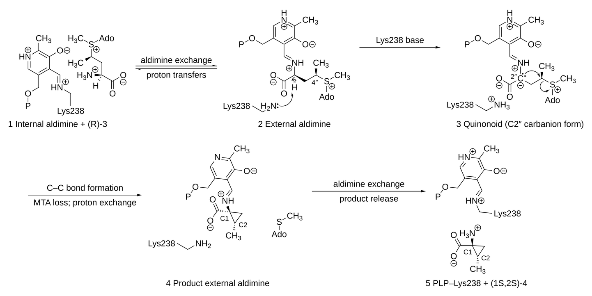](figures/orf30_gpt-6.1-sol_high.png) |
| Luna 6 high | 12:17 | 40/40 | FAIL | The post-cyclization structure is incorrect and does not match the paper's mechanism. | — | 95,838 | — | [](figures/orf30_gpt-6-luna_high.png) |

### 4-Oxalocrotonate tautomerase

doi:10.1016/j.bioorg.2007.08.003. Reference: Scheme 2.

| Model | Time (m:ss) | Checks | Verdict | Reason for PARTIAL / FAIL | Claude tokens (in + out) | Codex tokens (total) | Claude API cost | Figure |
|---|---:|---|---|---|---:|---:|---:|---|
| Sonnet 5.5 high | 11:48 | 44/44 | PASS | — | 1,076,833 | — | $0.50 | [](figures/fourot_sonnet_high.png) |
| Haiku 5.5 high | 18:17 | 41/41 | PASS | — | 4,048,219 | — | $0.21 | [](figures/fourot_haiku_high.png) |
| Sol 6.1 high | 8:47 | 45/45 | PASS | — | — | 87,662 | — | [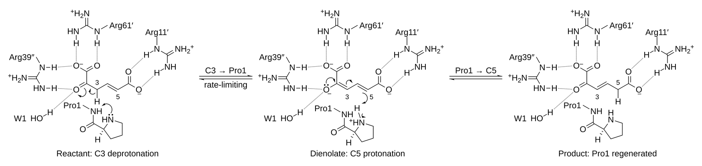](figures/fourot_gpt-6.1-sol_high.png) |
| Luna 6 high | 3:29 | 43/43 | PASS | — | — | 52,722 | — | [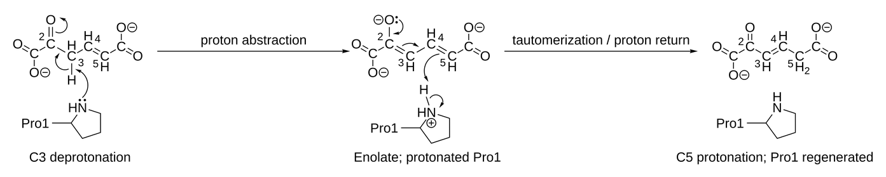](figures/fourot_gpt-6-luna_high.png) |

### Haloalcohol dehalogenase HheC

doi:10.1021/ct8000443. Reference: Scheme 2.

| Model | Time (m:ss) | Checks | Verdict | Reason for PARTIAL / FAIL | Claude tokens (in + out) | Codex tokens (total) | Claude API cost | Figure |
|---|---:|---|---|---|---:|---:|---:|---|
| Sonnet 5.5 high | 24:10 | 41/41 | PASS | — | 1,943,556 | — | $0.71 | [](figures/hhec_sonnet_high.png) |
| Haiku 5.5 high | 16:12 | 42/42 | PARTIAL | Main reaction is correct, but the Asp80 attachment point and Ser132 hydrogen bond differ from the reference figure. | 2,179,714 | — | $0.10 | [](figures/hhec_haiku_high.png) |
| Sol 6.1 high | 7:55 | 42/42 | PASS | — | — | 75,669 | — | [](figures/hhec_gpt-6.1-sol_high.png) |
| Luna 6 high | 45:36 | 44/44 | FAIL | Cyclization step is clear, but the reacting Arg149 is drawn as a nitrogen radical with an incorrect H count. | — | 162,931 | — | [](figures/hhec_gpt-6-luna_high.png) |

### SET7/9

doi:10.1002/jcc.21458. Reference: Scheme 1 and main text.

| Model | Time (m:ss) | Checks | Verdict | Reason for PARTIAL / FAIL | Claude tokens (in + out) | Codex tokens (total) | Claude API cost | Figure |
|---|---:|---|---|---|---:|---:|---:|---|
| Sonnet 5.5 high | 1:11 | 37/37 | PASS | — | 496,793 | — | $0.27 | [](figures/set79_sonnet_high.png) |
| Haiku 5.5 high | 1:25 | 41/41 | PASS | — | 840,433 | — | $0.02 | [](figures/set79_haiku_high.png) |
| Sol 6.1 high | 2:55 | 38/38 | PASS | — | — | 47,898 | — | [](figures/set79_gpt-6.1-sol_high.png) |
| Luna 6 high | 16:23 | 37/37 | PASS | — | — | 129,420 | — | [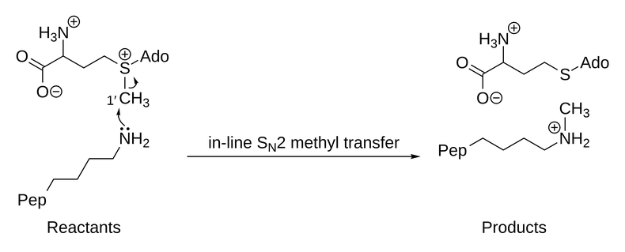](figures/set79_gpt-6-luna_high.png) |

### Chorismate mutase

doi:10.1039/b313759g. Reference: Figure 1.

| Model | Time (m:ss) | Checks | Verdict | Reason for PARTIAL / FAIL | Claude tokens (in + out) | Codex tokens (total) | Claude API cost | Figure |
|---|---:|---|---|---|---:|---:|---:|---|
| Sonnet 5.5 high | 11:51 | 43/43 | PASS | — | 1,351,590 | — | $0.64 | [](figures/cm_sonnet_high.png) |
| Haiku 5.5 high | 7:25 | 39/39 | PARTIAL | Skeleton, charges, and electron flow are correct, but the product's relative configuration is omitted. | 1,268,582 | — | $0.04 | [](figures/cm_haiku_high.png) |
| Sol 6.1 high | 5:50 | 39/39 | PASS | — | — | 88,591 | — | [](figures/cm_gpt-6.1-sol_high.png) |
| Luna 6 high | 9:45 | 35/35 | PARTIAL | Bond changes and charges are correct, but the configuration shown in the paper is omitted and check records are inconsistent. | — | 77,103 | — | [](figures/cm_gpt-6-luna_high.png) |

### Chorismate mutase with its transition state

doi:10.1039/b313759g. Reference: Figure 1 (with transition state).

| Model | Time (m:ss) | Checks | Verdict | Reason for PARTIAL / FAIL | Claude tokens (in + out) | Codex tokens (total) | Claude API cost | Figure |
|---|---:|---|---|---|---:|---:|---:|---|
| Sonnet 5.5 high | 15:01 | 46/46 | PASS | — | 3,867,163 | — | $1.17 | [](figures/cmts_sonnet_high.png) |
| Haiku 5.5 high | 11:33 | 42/42 | PARTIAL | Reaction and transition state are correct, but the product's relative configuration is omitted. | 3,414,681 | — | $0.28 | [](figures/cmts_haiku_high.png) |
| Sol 6.1 high | 12:27 | 46/46 | PASS | — | — | 105,127 | — | [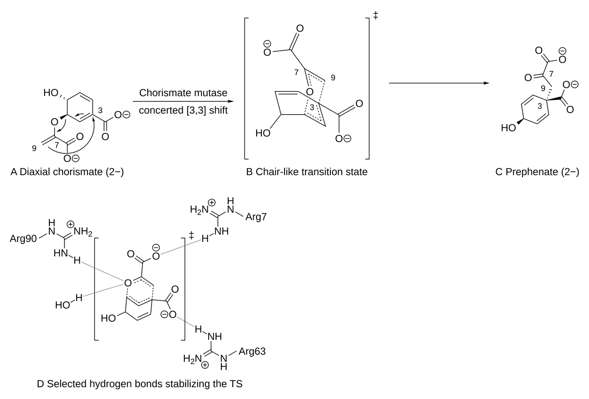](figures/cmts_gpt-6.1-sol_high.png) |
| Luna 6 high | 14:09 | 38/38 | PARTIAL | Bond changes are correct, but the reactant configuration is omitted and bonds cross in the transition state. | — | 92,975 | — | [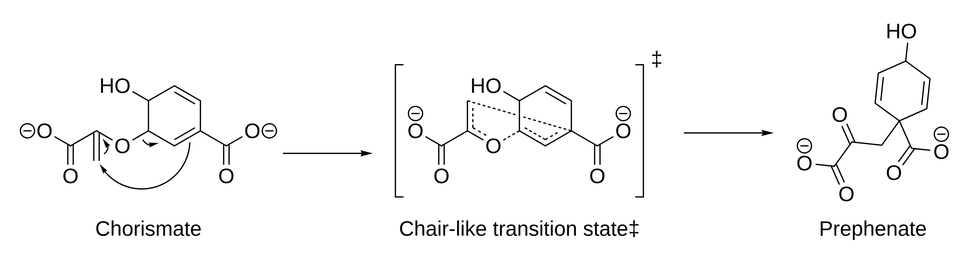](figures/cmts_gpt-6-luna_high.png) |

### Chymotrypsin

Textbook mechanism (no reference paper).

| Model | Time (m:ss) | Checks | Verdict | Reason for PARTIAL / FAIL | Claude tokens (in + out) | Codex tokens (total) | Claude API cost | Figure |
|---|---:|---|---|---|---:|---:|---:|---|
| Sonnet 5.5 high | 56:05 | 41/41 | PASS | — | 4,994,935 | — | $1.52 | [](figures/chymo_sonnet_high.png) |
| Haiku 5.5 high | 19:40 | 41/41 | PARTIAL | All four main steps are shown, but two proton-transfer arrows are incorrect. | 4,358,091 | — | $0.23 | [](figures/chymo_haiku_high.png) |
| Sol 6.1 high | 13:42 | 41/41 | PASS | — | — | 116,548 | — | [](figures/chymo_gpt-6.1-sol_high.png) |
| Luna 6 high | 11:30 | 40/40 | PASS | — | — | 87,925 | — | [](figures/chymo_gpt-6-luna_high.png) |

### Aldol condensation

Textbook mechanism (no reference paper).

| Model | Time (m:ss) | Checks | Verdict | Reason for PARTIAL / FAIL | Claude tokens (in + out) | Codex tokens (total) | Claude API cost | Figure |
|---|---:|---|---|---|---:|---:|---:|---|
| Sonnet 5.5 high | 2:31 | 37/37 | PARTIAL | Species and product are correct, but three curved arrows are missing. | 641,349 | — | $0.42 | [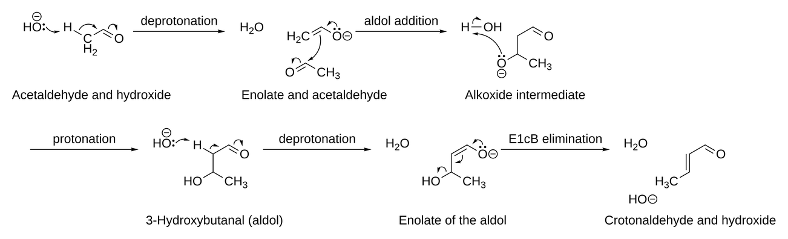](figures/aldol_sonnet_high.png) |
| Haiku 5.5 high | 3:22 | 37/37 | PARTIAL | Pathway and product are correct, but one curved arrow is missing in the addition step (step 2). | 791,136 | — | $0.04 | [](figures/aldol_haiku_high.png) |
| Sol 6.1 high | 4:26 | 37/37 | PASS | — | — | 74,538 | — | [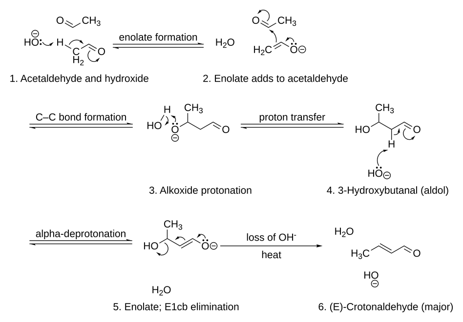](figures/aldol_gpt-6.1-sol_high.png) |
| Luna 6 high | 4:48 | 37/37 | PASS | — | — | 61,179 | — | [](figures/aldol_gpt-6-luna_high.png) |

### Radical addition of HBr to propene

Textbook mechanism (no reference paper).

| Model | Time (m:ss) | Checks | Verdict | Reason for PARTIAL / FAIL | Claude tokens (in + out) | Codex tokens (total) | Claude API cost | Figure |
|---|---:|---|---|---|---:|---:|---:|---|
| Sonnet 5.5 high | 2:15 | 29/29 | PASS | — | 543,737 | — | $0.33 | [](figures/radical_sonnet_high.png) |
| Haiku 5.5 high | 4:46 | 29/29 | PARTIAL | Chain reaction is correct, but the `2 RO•` formed by peroxide homolysis is omitted. | 1,118,670 | — | $0.04 | [](figures/radical_haiku_high.png) |
| Sol 6.1 high | 2:23 | 29/29 | PASS | — | — | 43,751 | — | [](figures/radical_gpt-6.1-sol_high.png) |
| Luna 6 high | 5:52 | 29/29 | PARTIAL | Product and chain skeleton are correct, but the ROH byproduct in initiation is omitted and the H-abstraction arrow is unclear. | — | 58,141 | — | [](figures/radical_gpt-6-luna_high.png) |

### Carbonic anhydrase II

Textbook mechanism (no reference paper).

| Model | Time (m:ss) | Checks | Verdict | Reason for PARTIAL / FAIL | Claude tokens (in + out) | Codex tokens (total) | Claude API cost | Figure |
|---|---:|---|---|---|---:|---:|---:|---|
| Sonnet 5.5 high | 9:27 | 41/41 | PASS | — | 1,981,673 | — | $0.70 | [](figures/metal_sonnet_high.png) |
| Haiku 5.5 high | 5:52 | 41/41 | PARTIAL | Main steps and electron flow are correct, but His119 coordinates through the wrong nitrogen in every panel. | 883,342 | — | $0.04 | [](figures/metal_haiku_high.png) |
| Sol 6.1 high | 11:02 | 41/41 | PASS | — | — | 95,019 | — | [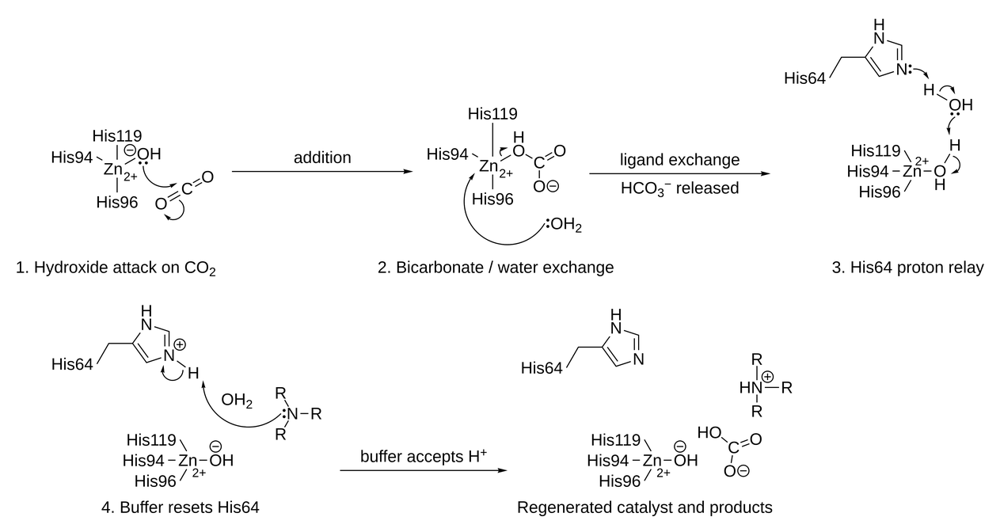](figures/metal_gpt-6.1-sol_high.png) |
| Luna 6 high | 21:07 | 43/43 | FAIL | All required steps are shown, but the zinc-bound hydroxide is missing its H and the product is drawn as a radical instead of bicarbonate. | — | 187,955 | — | [](figures/metal_gpt-6-luna_high.png) |
