# Benchmark

[English](README.md) | [日本語](README.ja.md)

Four models were tested at high effort on 11 reaction-mechanism problems (44 runs): two Claude models (Sonnet 5.5 and Haiku 5.5) in Claude Code, and two GPT models (Sol 6.2 and Luna 6) in Codex CLI. 43 of the 44 runs passed the automated drawing checks, and independent judging found **26 runs passed (PASS), 15 had concerns (PARTIAL), and 3 failed (FAIL)**.

## Setup and prompts

Each run started in a clean directory containing only the `./reaction-draw/` skill folder and, for paper-based problems, the source paper in `./paper/` (including Supporting Information for Orf30). Claude Code ran with `claude -p --safe-mode`, and Codex CLI ran with an empty `HOME`. Each agent received a single prompt with no additional instructions or follow-up.

Paper problems (6 problems; `<DOI>` is the paper's DOI):

```text
Draw the enzyme reaction mechanism proposed in the paper in ./paper/ (doi:<DOI>) as a curved-arrow figure. Use the skill in ./reaction-draw/. Work in this directory and save the figure in ./out/.
```

Chorismate mutase with its transition state (1 problem):

```text
Draw the enzyme reaction mechanism proposed in the paper in ./paper/ (doi:<DOI>), including its transition state, as a curved-arrow figure. Use the skill in ./reaction-draw/. Work in this directory and save the figure in ./out/.
```

Textbook problems (4 problems; `<TOPIC>` listed below):

```text
Draw the reaction mechanism of <TOPIC> as a curved-arrow figure. Use the skill in ./reaction-draw/. Work in this directory and save the figure in ./out/.
```

- **Chymotrypsin**: the hydrolysis of a peptide bond by chymotrypsin (catalytic triad Ser195, His57, Asp102; oxyanion hole), acylation and deacylation,
- **Aldol condensation**: the base-catalysed (hydroxide) aldol condensation of two acetaldehyde molecules to crotonaldehyde
- **Radical addition**: the peroxide-initiated radical addition of HBr to propene giving 1-bromopropane (initiation and the two propagation steps)
- **Carbonic anhydrase**: the hydration of CO2 by carbonic anhydrase II (Zn2+ bound to His94, His96 and His119; the zinc-bound hydroxide attacks CO2; bicarbonate release and regeneration of the zinc-bound hydroxide)

## Judging

In addition to the automated drawing checks, an independent GPT Sol 6.2 xhigh judge evaluated each figure against the paper's mechanism figure (or a written reference mechanism for textbook problems) for chemical accuracy, skill usage, and readability:

- **PASS**: Chemically accurate and complete enough to represent the reference mechanism, passes all drawing checks, and is visually readable.
- **PARTIAL**: Usable figure with a specific chemistry gap or failed drawing check.
- **FAIL**: Incorrect chemistry, a missing key step, or no output figure.

The verdicts and the reasons for PARTIAL and FAIL below are taken from the judge's saved assessments.

## Summary by model

Each row covers 11 high-effort runs (one per problem); times, token counts, and costs are per-run medians. For Claude, token counts sum all input (uncached, cache writes, and cache reads) and output (including thinking) tokens, and costs are list-price USD estimates. For Codex, only the CLI-reported total `tokens used` was recorded. Because Claude and Codex count tokens differently, their token counts are not directly comparable.

| Model | Runs | PASS | PARTIAL | FAIL | Median time (m:ss) | Median Claude tokens (in + out) | Median Codex tokens (total) | Median Claude API cost |
|---|---:|---:|---:|---:|---:|---:|---:|---:|
| Sonnet 5.5 high | 11 | 7 | 4 | 0 | 2:28 | 583,169 | — | $0.41 |
| Haiku 5.5 high | 11 | 5 | 6 | 0 | 5:07 | 1,024,577 | — | $0.05 |
| Sol 6.2 high | 11 | 9 | 2 | 0 | 4:17 | — | 67,026 | — |
| Luna 6 high | 11 | 5 | 3 | 3 | 4:22 | — | 51,954 | — |

## Figures by problem

Times reflect elapsed wall-clock time, and `Checks` is the automated check score of the final drawing. Click any preview to open the 150 dpi image.

### BezA

doi:10.1002/anie.202111217. Reference: Figure 4.

| Model | Time (m:ss) | Checks | Verdict | Reason for PARTIAL / FAIL | Claude tokens (in + out) | Codex tokens (total) | Claude API cost | Figure |
|---|---:|---|---|---|---:|---:|---:|---|
| Sonnet 5.5 high | 1:19 | 46/46 | PASS | — | 649,072 | — | $0.34 | [](figures/beza_sonnet_high.png) |
| Haiku 5.5 high | 1:26 | 46/46 | PASS | — | 594,376 | — | $0.02 | [](figures/beza_haiku_high.png) |
| Sol 6.2 high | 2:25 | 46/46 | PASS | — | — | 53,553 | — | [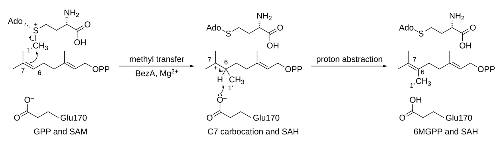](figures/beza_gpt-6.2-sol_high.png) |
| Luna 6 high | 1:14 | 49/49 | PASS | — | — | 45,001 | — | [](figures/beza_gpt-6-luna_high.png) |

### Orf30

doi:10.1021/jacs.6c13085. Reference: Figure S14 and main text.

| Model | Time (m:ss) | Checks | Verdict | Reason for PARTIAL / FAIL | Claude tokens (in + out) | Codex tokens (total) | Claude API cost | Figure |
|---|---:|---|---|---|---:|---:|---:|---|
| Sonnet 5.5 high | 6:09 | 47/47 | PARTIAL | The cyclization and product stereochemistry match the paper’s figure, with Lys238 deprotonation and its nucleophilic attack arrow missing from the PLP regeneration step. | 1,135,156 | — | $0.77 | [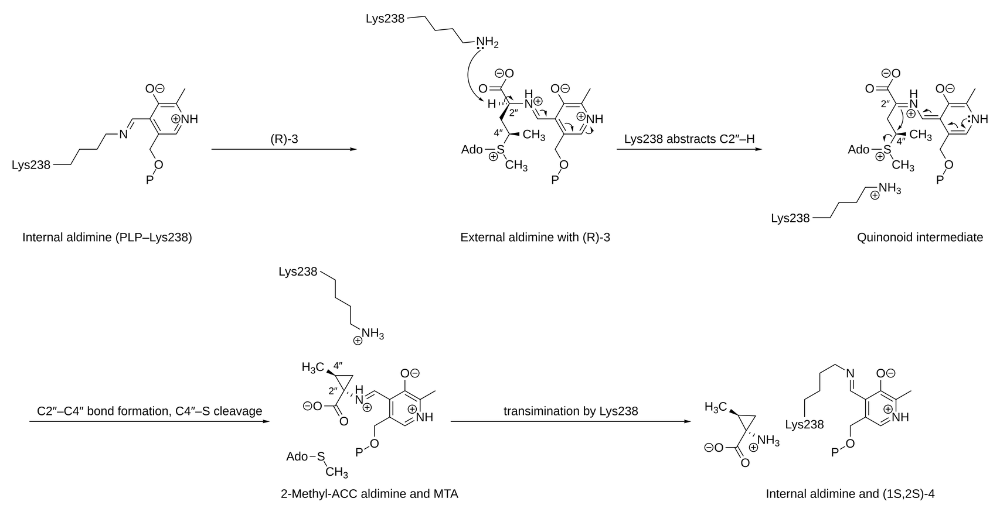](figures/orf30_sonnet_high.png) |
| Haiku 5.5 high | 13:00 | 47/47 | PARTIAL | The figure correctly shows cyclization and product stereochemistry, but Lys238 remains protonated at product release, its attack arrow is missing, and the first curved arrow crosses a PLP bond. | 1,262,302 | — | $0.14 | [](figures/orf30_haiku_high.png) |
| Sol 6.2 high | 13:32 | 47/47 | PARTIAL | In the external aldimine, the curved arrow from the C2″–H bond crosses the bond to the carboxylate, making the electron source hard to identify. | — | 125,955 | — | [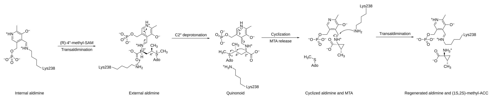](figures/orf30_gpt-6.2-sol_high.png) |
| Luna 6 high | 27:29 | 47/47 | FAIL | The substrate has the opposite configuration at C2″ from the reference, and the Lys238 attack during product release is missing, so the figure cannot represent the paper’s mechanism. | — | 125,554 | — | [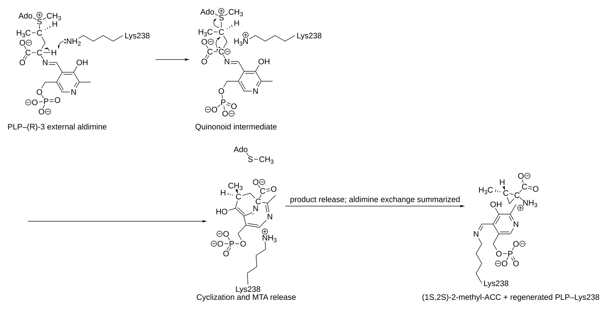](figures/orf30_gpt-6-luna_high.png) |

### 4-Oxalocrotonate tautomerase

doi:10.1016/j.bioorg.2007.08.003. Reference: Scheme 2.

| Model | Time (m:ss) | Checks | Verdict | Reason for PARTIAL / FAIL | Claude tokens (in + out) | Codex tokens (total) | Claude API cost | Figure |
|---|---:|---|---|---|---:|---:|---:|---|
| Sonnet 5.5 high | 2:35 | 47/47 | PARTIAL | The C2=C3 bond in the upper-right dienolate intermediate is drawn with a different geometry from Scheme 2. | 583,169 | — | $0.41 | [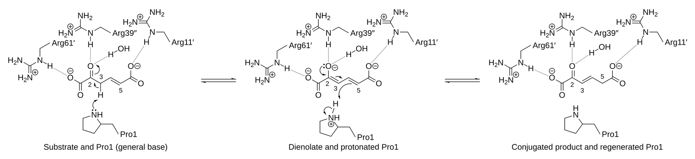](figures/fourot_sonnet_high.png) |
| Haiku 5.5 high | 5:37 | 48/48 | PARTIAL | The intermediate needs correction because its C2=C3 double-bond geometry is reversed relative to Scheme 2. | 1,312,488 | — | $0.14 | [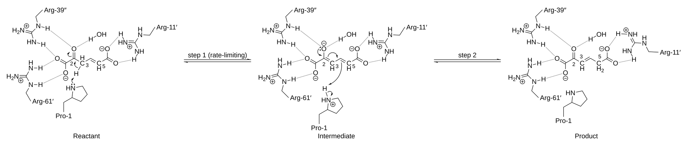](figures/fourot_haiku_high.png) |
| Sol 6.2 high | 4:27 | 48/48 | PASS | — | — | 101,764 | — | [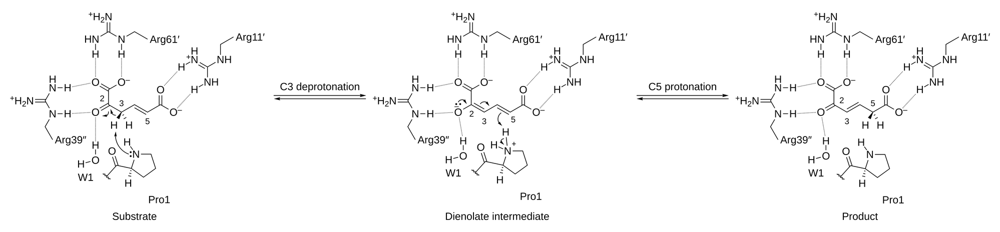](figures/fourot_gpt-6.2-sol_high.png) |
| Luna 6 high | 3:08 | 46/46 | FAIL | All three panels insert an extra CH₂ between C5 and the terminal carboxylate, turning the paper’s six-carbon skeleton into a seven-carbon skeleton. | — | 56,685 | — | [](figures/fourot_gpt-6-luna_high.png) |

### Haloalcohol dehalogenase HheC

doi:10.1021/ct8000443. Reference: Scheme 2.

| Model | Time (m:ss) | Checks | Verdict | Reason for PARTIAL / FAIL | Claude tokens (in + out) | Codex tokens (total) | Claude API cost | Figure |
|---|---:|---|---|---|---:|---:|---:|---|
| Sonnet 5.5 high | 4:51 | 44/44 | PARTIAL | The concerted ring closure and chloride loss are clear, but two curved arrows in the left panel start at O–H bonds instead of the oxygen atoms shown in Scheme 2 and need correction before the figure can represent the published mechanism. | 989,179 | — | $0.57 | [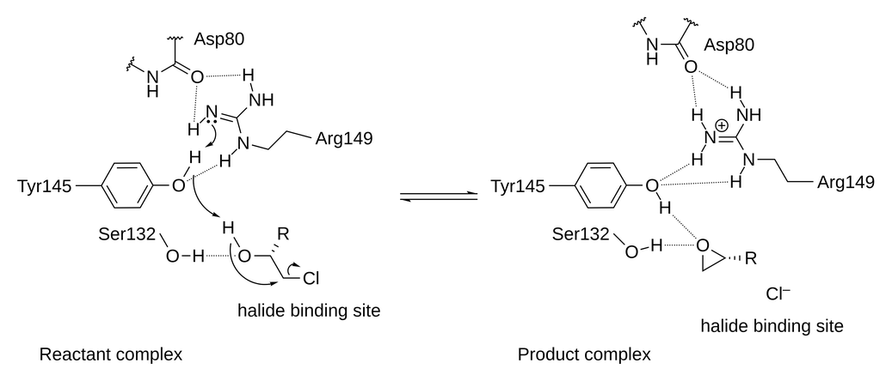](figures/hhec_sonnet_high.png) |
| Haiku 5.5 high | 5:07 | 44/44 | PASS | — | 1,625,244 | — | $0.11 | [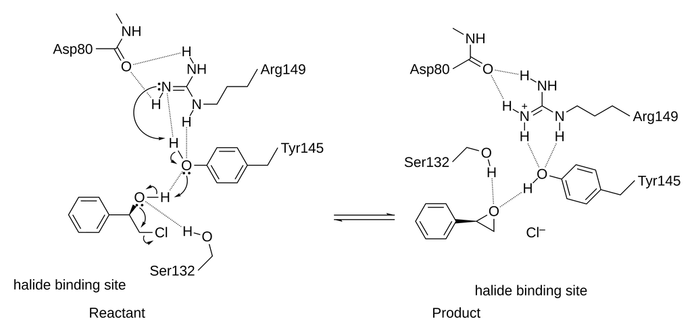](figures/hhec_haiku_high.png) |
| Sol 6.2 high | 5:38 | 44/44 | PASS | — | — | 67,026 | — | [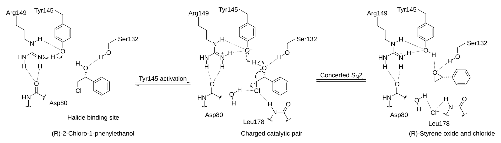](figures/hhec_gpt-6.2-sol_high.png) |
| Luna 6 high | 3:10 | 44/44 | PASS | — | — | 54,229 | — | [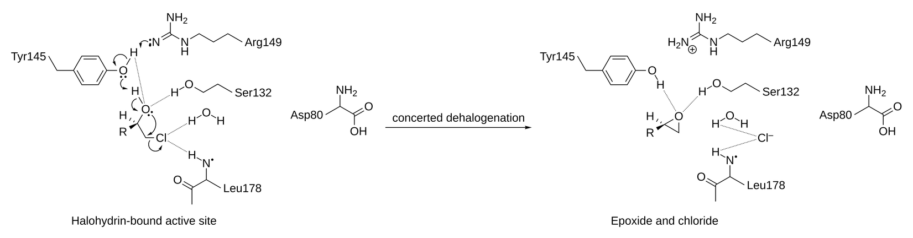](figures/hhec_gpt-6-luna_high.png) |

### SET7/9

doi:10.1002/jcc.21458. Reference: Scheme 1 and main text.

| Model | Time (m:ss) | Checks | Verdict | Reason for PARTIAL / FAIL | Claude tokens (in + out) | Codex tokens (total) | Claude API cost | Figure |
|---|---:|---|---|---|---:|---:|---:|---|
| Sonnet 5.5 high | 1:27 | 44/44 | PASS | — | 555,179 | — | $0.32 | [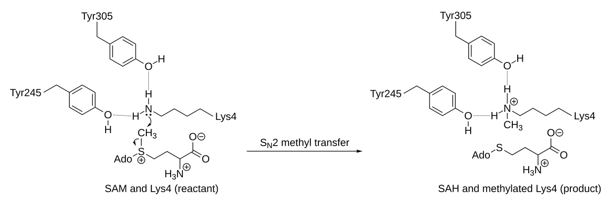](figures/set79_sonnet_high.png) |
| Haiku 5.5 high | 1:35 | 45/45 | PASS | — | 841,556 | — | $0.03 | [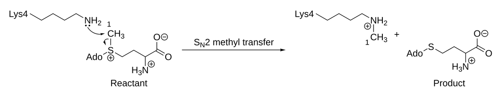](figures/set79_haiku_high.png) |
| Sol 6.2 high | 2:51 | 44/44 | PASS | — | — | 91,241 | — | [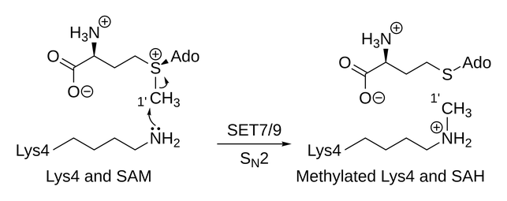](figures/set79_gpt-6.2-sol_high.png) |
| Luna 6 high | 1:51 | 44/44 | PARTIAL | The SET7/9 methyl transfer is drawn correctly and passes the drawing checks, but the reacting lysine is not identified as Lys4. | — | 30,786 | — | [](figures/set79_gpt-6-luna_high.png) |

### Chorismate mutase

doi:10.1039/b313759g. Reference: Figure 1.

| Model | Time (m:ss) | Checks | Verdict | Reason for PARTIAL / FAIL | Claude tokens (in + out) | Codex tokens (total) | Claude API cost | Figure |
|---|---:|---|---|---|---:|---:|---:|---|
| Sonnet 5.5 high | 4:57 | 46/46 | PASS | — | 963,344 | — | $0.47 | [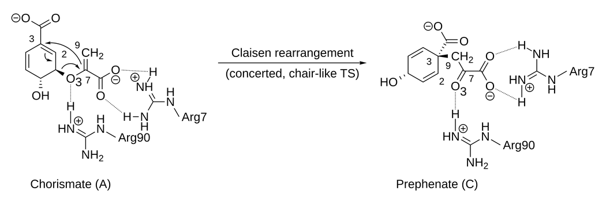](figures/cm_sonnet_high.png) |
| Haiku 5.5 high | 7:01 | 46/46 | PARTIAL | The Claisen rearrangement is shown correctly, but the two Arg7 hydrogen bonds on the left are drawn from the same nitrogen, whereas the paper assigns them to two different nitrogens. | 2,869,527 | — | $0.27 | [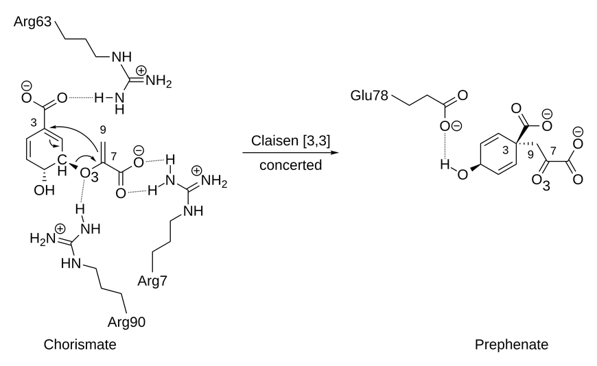](figures/cm_haiku_high.png) |
| Sol 6.2 high | 3:12 | 41/41 | PASS | — | — | 60,937 | — | [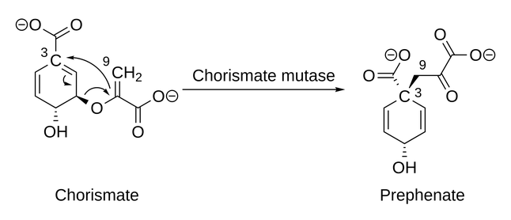](figures/cm_gpt-6.2-sol_high.png) |
| Luna 6 high | 4:41 | 41/41 | PARTIAL | The figure is usable as a schematic of the one-step Claisen rearrangement, but it omits the stereochemistry of both the substrate and the product. | — | 82,788 | — | [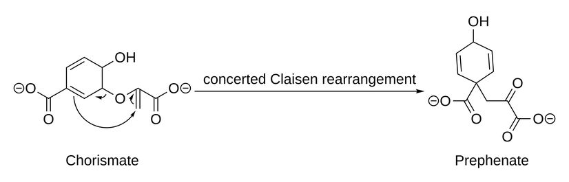](figures/cm_gpt-6-luna_high.png) |

### Chorismate mutase with its transition state

doi:10.1039/b313759g. Reference: Figure 1 (with transition state).

| Model | Time (m:ss) | Checks | Verdict | Reason for PARTIAL / FAIL | Claude tokens (in + out) | Codex tokens (total) | Claude API cost | Figure |
|---|---:|---|---|---|---:|---:|---:|---|
| Sonnet 5.5 high | 2:28 | 49/49 | PARTIAL | The forming bond uses a different carbon number from the paper, so the label needs correction for direct comparison with the paper. | 759,300 | — | $0.49 | [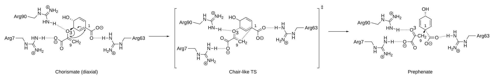](figures/cmts_sonnet_high.png) |
| Haiku 5.5 high | 6:01 | 44/44 | PARTIAL | The bond changes and transition state are drawn correctly, but the carbon in the breaking C–O3 bond is labeled “5,” which identifies a different carbon in the paper. | 1,819,727 | — | $0.16 | [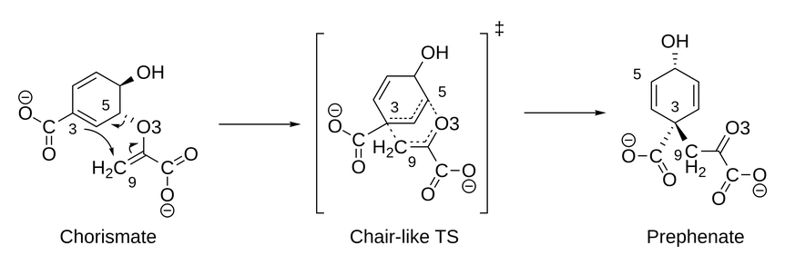](figures/cmts_haiku_high.png) |
| Sol 6.2 high | 6:55 | 49/49 | PASS | — | — | 100,066 | — | [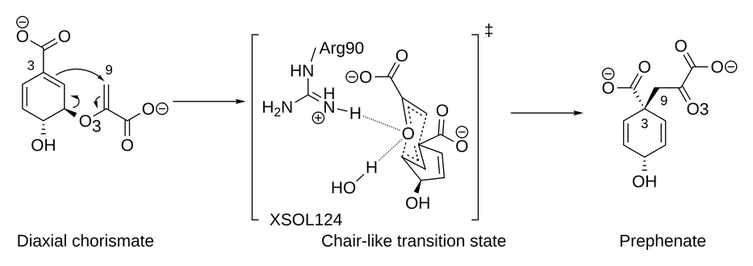](figures/cmts_gpt-6.2-sol_high.png) |
| Luna 6 high | 8:23 | 38/39 | FAIL | The substrate and product stereochemistry differ from the paper’s figure, and the transition state has problems with bond notation and label placement. | — | 97,375 | — | [](figures/cmts_gpt-6-luna_high.png) |

### Chymotrypsin

Textbook mechanism (no reference paper).

| Model | Time (m:ss) | Checks | Verdict | Reason for PARTIAL / FAIL | Claude tokens (in + out) | Codex tokens (total) | Claude API cost | Figure |
|---|---:|---|---|---|---:|---:|---:|---|
| Sonnet 5.5 high | 3:44 | 44/44 | PASS | — | 542,838 | — | $0.53 | [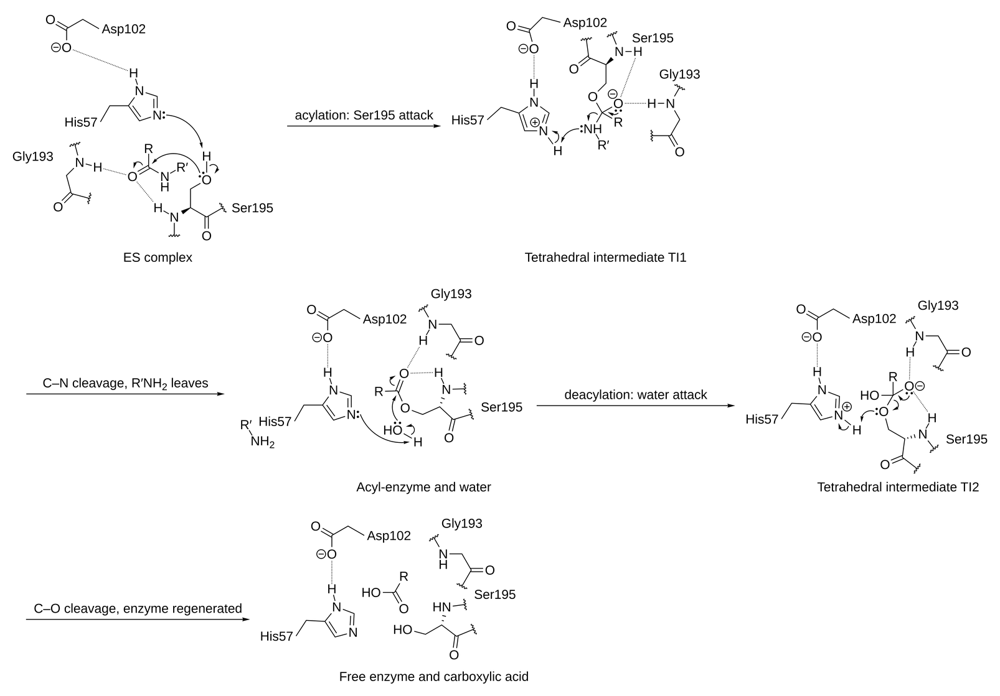](figures/chymo_sonnet_high.png) |
| Haiku 5.5 high | 5:58 | 44/44 | PASS | — | 824,495 | — | $0.05 | [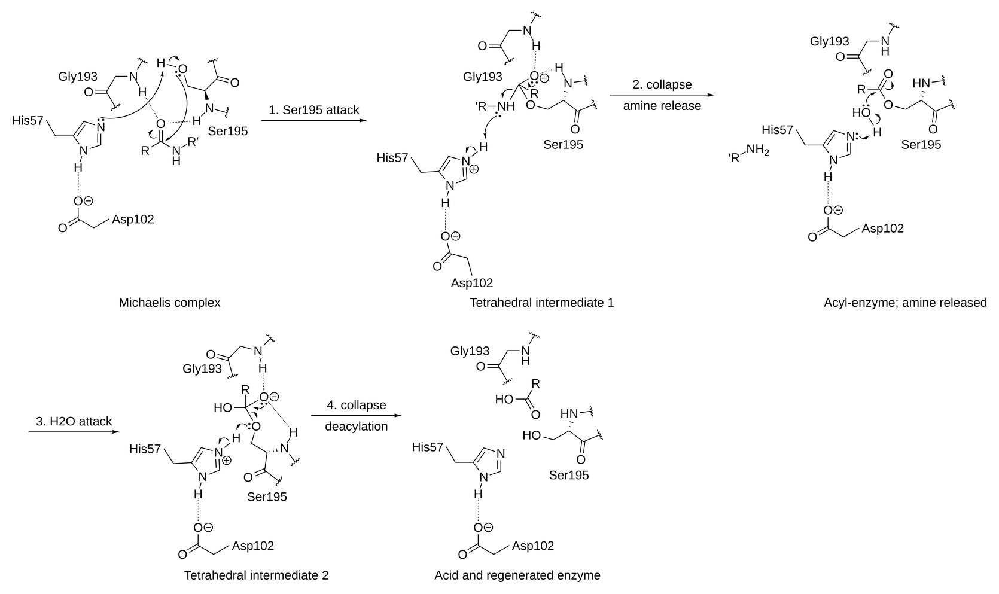](figures/chymo_haiku_high.png) |
| Sol 6.2 high | 8:25 | 44/44 | PASS | — | — | 108,864 | — | [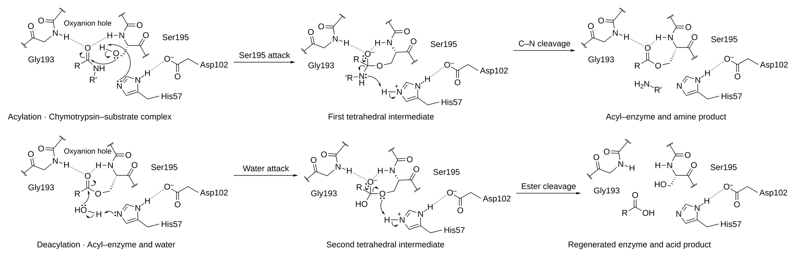](figures/chymo_gpt-6.2-sol_high.png) |
| Luna 6 high | 4:22 | 48/48 | PASS | — | — | 46,071 | — | [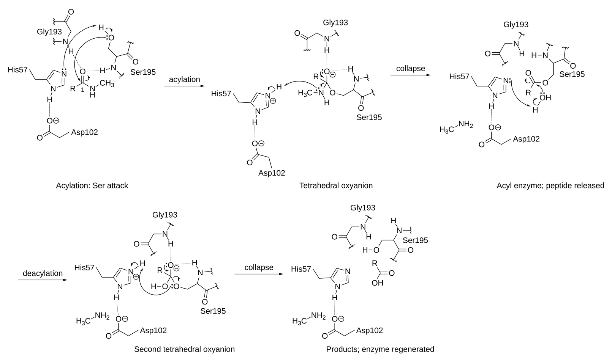](figures/chymo_gpt-6-luna_high.png) |

### Aldol condensation

Textbook mechanism (no reference paper).

| Model | Time (m:ss) | Checks | Verdict | Reason for PARTIAL / FAIL | Claude tokens (in + out) | Codex tokens (total) | Claude API cost | Figure |
|---|---:|---|---|---|---:|---:|---:|---|
| Sonnet 5.5 high | 1:47 | 39/39 | PASS | — | 321,974 | — | $0.28 | [](figures/aldol_sonnet_high.png) |
| Haiku 5.5 high | 4:00 | 39/39 | PASS | — | 573,081 | — | $0.04 | [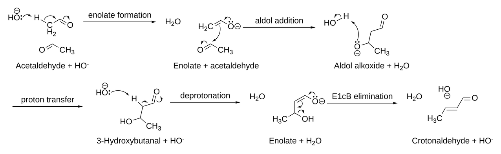](figures/aldol_haiku_high.png) |
| Sol 6.2 high | 2:18 | 39/39 | PASS | — | — | 41,088 | — | [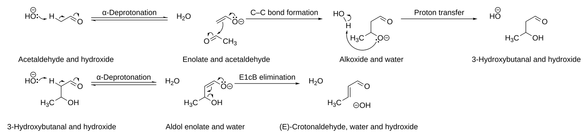](figures/aldol_gpt-6.2-sol_high.png) |
| Luna 6 high | 6:44 | 44/44 | PASS | — | — | 51,954 | — | [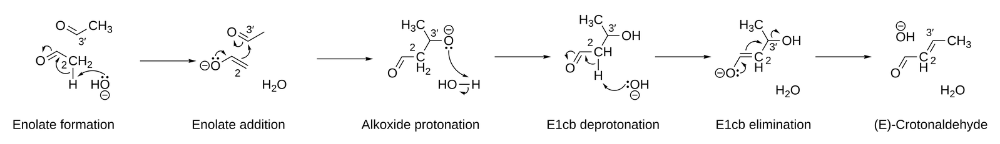](figures/aldol_gpt-6-luna_high.png) |

### Radical addition of HBr to propene

Textbook mechanism (no reference paper).

| Model | Time (m:ss) | Checks | Verdict | Reason for PARTIAL / FAIL | Claude tokens (in + out) | Codex tokens (total) | Claude API cost | Figure |
|---|---:|---|---|---|---:|---:|---:|---|
| Sonnet 5.5 high | 1:30 | 31/31 | PASS | — | 364,738 | — | $0.26 | [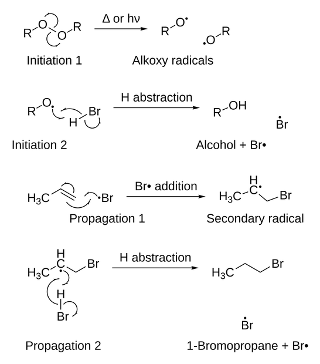](figures/radical_sonnet_high.png) |
| Haiku 5.5 high | 2:45 | 31/31 | PARTIAL | The mechanism is drawn correctly, but in the first propagation step, the fishhook tail is far enough from the double bond that the electron source is hard to identify. | 437,662 | — | $0.03 | [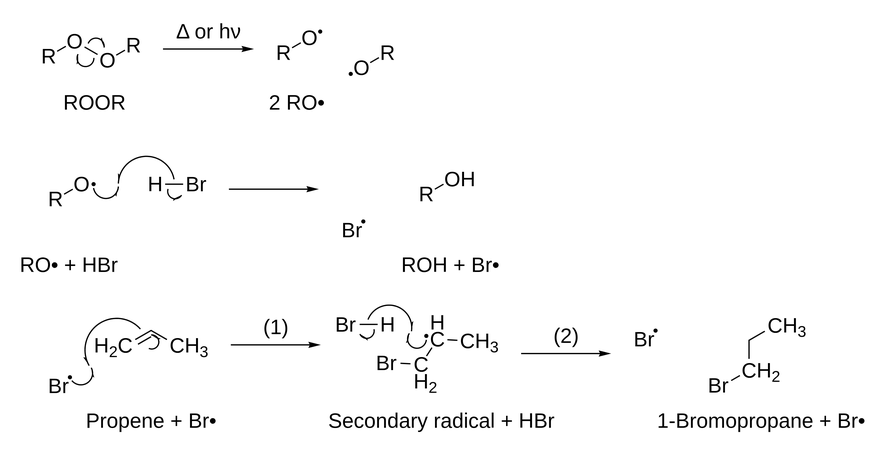](figures/radical_haiku_high.png) |
| Sol 6.2 high | 1:41 | 32/32 | PASS | — | — | 35,506 | — | [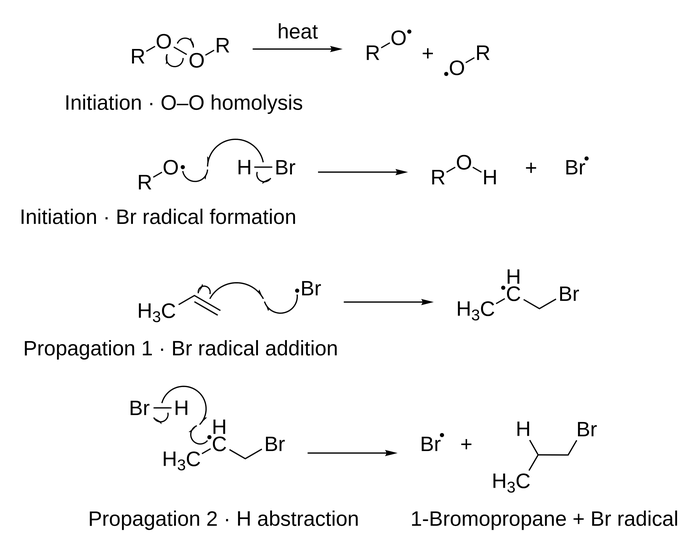](figures/radical_gpt-6.2-sol_high.png) |
| Luna 6 high | 2:12 | 35/35 | PARTIAL | The figure shows one too few OH radicals from hydrogen peroxide homolysis, and the initiation hydrogen-transfer arrow stops short of the hydrogen atom. | — | 24,000 | — | [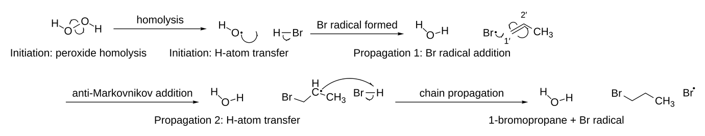](figures/radical_gpt-6-luna_high.png) |

### Carbonic anhydrase II

Textbook mechanism (no reference paper).

| Model | Time (m:ss) | Checks | Verdict | Reason for PARTIAL / FAIL | Claude tokens (in + out) | Codex tokens (total) | Claude API cost | Figure |
|---|---:|---|---|---|---:|---:|---:|---|
| Sonnet 5.5 high | 2:28 | 44/44 | PASS | — | 328,431 | — | $0.26 | [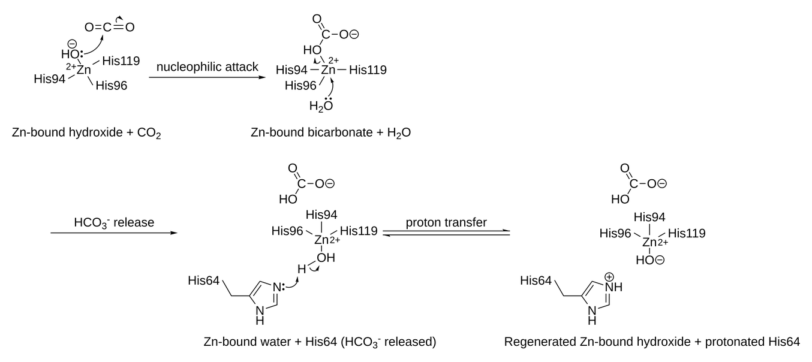](figures/metal_sonnet_high.png) |
| Haiku 5.5 high | 4:16 | 43/43 | PARTIAL | The carbonic anhydrase II mechanism and charges match the reference, but the ligand-exchange arrow is detached from the intermediate in the top row, making the sequence across rows hard to follow. | 1,024,577 | — | $0.05 | [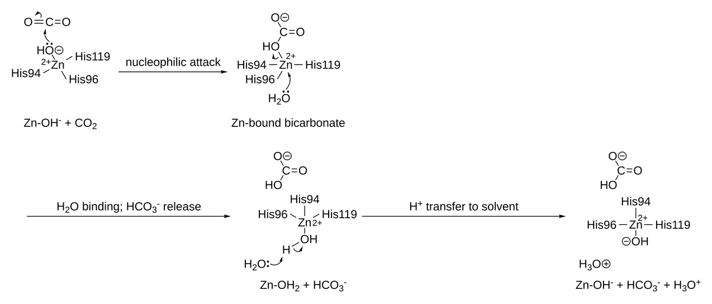](figures/metal_haiku_high.png) |
| Sol 6.2 high | 4:17 | 44/44 | PARTIAL | The mechanism is correct, but a curved arrow in panel 3 crosses W1’s O–H bond, making the source of the electron pair hard to read. | — | 56,715 | — | [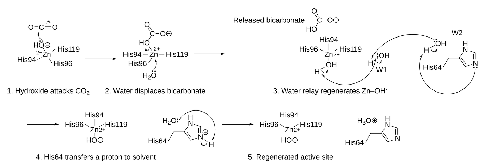](figures/metal_gpt-6.2-sol_high.png) |
| Luna 6 high | 4:29 | 48/48 | PASS | — | — | 27,424 | — | [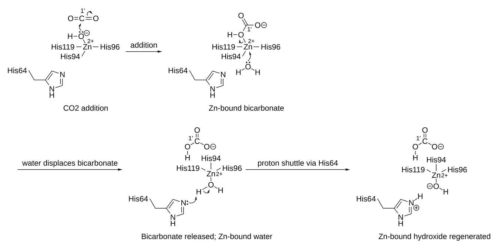](figures/metal_gpt-6-luna_high.png) |
