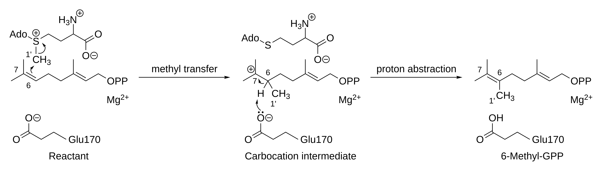

# Example: Two-step mechanism of BezA

BezA is a geranyl diphosphate (GPP) C6-methyltransferase. The figure below illustrates its proposed two-step mechanism, adapted from Tsutsumi et al., *Angew. Chem. Int. Ed.* **2022**, *61*, e202111217 (DOI: 10.1002/anie.202111217, Figure 4):

1. The methyl group of *S*-adenosylmethionine (SAM) transfers to C6 of GPP (at the C6=C7 alkene), forming a tertiary C7 cation and converting SAM to SAH.
2. The carboxylate of Glu170 (`E170`) removes the C6 proton, restoring the C6=C7 double bond to yield 6-methyl-GPP.

Here, `OPP` and `Ado` denote the diphosphate and adenosyl groups, respectively, with Mg²⁺ positioned next to the diphosphate.



**Input templates:** [`beza.json`](../../skills/reaction-draw/templates/beza.json) and two color-coded variants: [`beza_color_element.json`](../../skills/reaction-draw/templates/beza_color_element.json) (heteroatoms colored by element) and [`beza_color_origin.json`](../../skills/reaction-draw/templates/beza_color_origin.json) (groups colored by source molecule). The `beza_*` files in this directory are the renamed `.cdxml`, `.svg`, and `.png` (600 dpi) outputs generated from these templates.

To regenerate the figures from the skill directory (`skills/reaction-draw/`):

```bash
python scripts/draw_figure.py templates/beza.json --out out/beza
python scripts/draw_figure.py templates/beza_color_element.json --out out/beza_color_element
python scripts/draw_figure.py templates/beza_color_origin.json --out out/beza_color_origin
```
